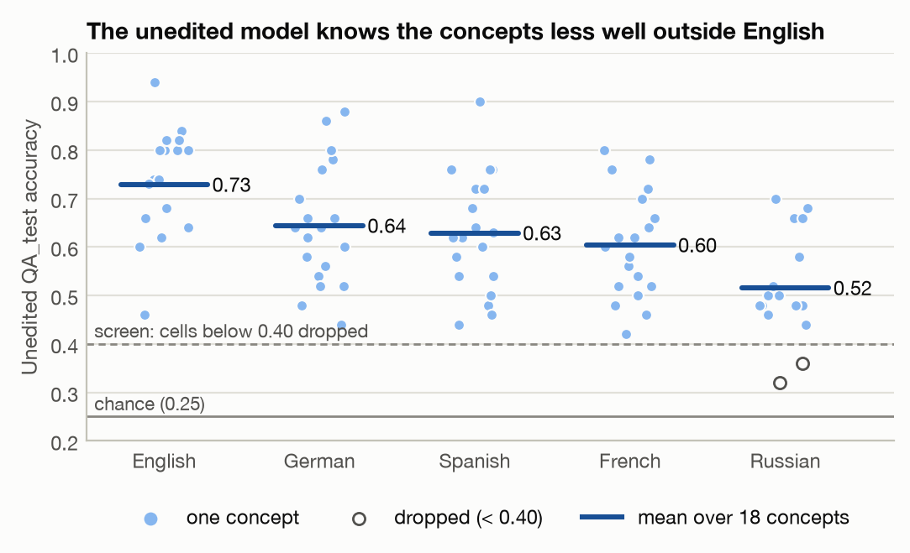
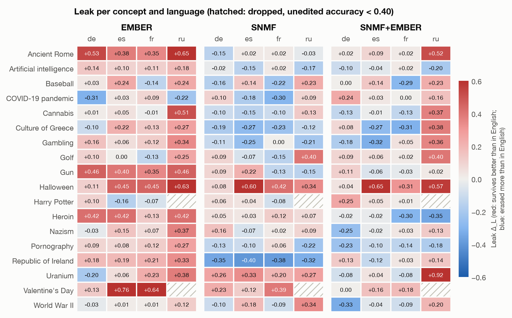

# English Edits, Other Languages: Does Concept Erasure Transfer Across Languages?

**Part 1 report: cross-lingual leakage of EMBER, SNMF and SNMF+EMBER on Gemma-2-2B-it**

Mary Arav, Ori Petel, Semyon Guretskiy (Tel Aviv University, NLP course 2025/26)

---

## Abstract

Concept erasure removes knowledge of a target concept (e.g. *Harry Potter*) from a language model's weights while keeping the rest of the model intact. EMBER, a recent method, does this by editing the input embeddings of a few dozen English tokens. Because those tokens are English, it is unclear whether the erasure still holds when the same concept is asked about in another language. We reproduce three erasure methods from the EMBER paper on Gemma-2-2B-it for all 18 of its concepts: EMBER (an embedding edit), SNMF (an MLP edit) and their combination SNMF+EMBER. We tune every edit in English only and then ask held-out multiple-choice questions in English, German, Spanish, French and Russian. We measure *retention* (how much of the concept survives, relative to the unedited model in the same language) and *leak* (retention in a language minus retention in English).

EMBER leaks: its mean leak is +0.19 (95% CI [+0.11, +0.27]), and in Russian it is +0.33, with Russian retention at 0.96, almost as if nothing had been erased. SNMF does not leak (+0.01, [−0.07, +0.08]), but it removes 24–41% of similar-domain knowledge and lowers English MMLU from 0.553 to 0.506. SNMF+EMBER erases English the most (retention 0.39). It does not leak into German, Spanish or French, but it still leaks into Russian (+0.23, [+0.08, +0.38]). Along the way we found that the original multiple-choice scorer cut answers off after four tokens, which counted correct answers as "erased" and inflated the erasure of the embedding-based methods. We fixed the scorer, re-selected all edits and re-ran every evaluation.

---

## 1. Introduction

A model may need to forget a concept for safety, copyright or privacy reasons. Persistent concept erasure changes the model's weights so that it can no longer use knowledge about the concept, while its other knowledge and its ability to write fluent text stay intact. A known weakness of current methods is that the erasure is shallow: the knowledge can come back after a little fine-tuning, a rephrased question, or a different question format.

Suslik, Shafran and Geva (2026) argue that part of the problem is that most erasure methods edit only the MLP layers and ignore the embedding layer, where token-level knowledge is also stored. Their method, EMBER, finds concept features in the embedding matrix and subtracts them from the embeddings of a small set of concept tokens. Added to MLP-based methods, it improves erasure and makes it much more robust to relearning.

EMBER's features and edited tokens all come from English Wikipedia text. An embedding edit changes specific rows of the vocabulary, and a question in another language, particularly one written in another script, may never touch an edited row. The EMBER paper names this as a limitation ("Language coverage"), but it does not measure it. We therefore ask: *if an erasure is tuned in English, does the concept re-emerge when the same questions are asked in another language, and does this differ between embedding-based and MLP-based erasure?*

To answer this, we reproduce three methods from the EMBER paper (EMBER, SNMF and SNMF+EMBER) on Gemma-2-2B-it for all 18 of its concepts. We replace the paper's paid Gemini judge with a local judge and validate it against Gemini, and we select one edit per concept and method using English data only. We then translate the evaluation questions into German, Spanish, French and Russian, apply each English edit once without re-tuning, and measure how much of the concept survives in each language. In the course of this work we also found and corrected an answer-parsing problem in the original multiple-choice scorer (Section 3.5).

Our main findings are as follows.

- EMBER leaks: the concept survives better in every other language than in English, and almost fully in Russian.
- SNMF erases about evenly across languages, but it damages related and general knowledge more.
- SNMF+EMBER erases English the most and leaks only into Russian, the one tested language with a different script.
- With the original scorer our numbers match those of the EMBER paper closely, but that scorer overstates the erasure of the embedding-based methods.

---

## 2. Background

### 2.1 Concept erasure

Given a model *M* and a concept *C*, the goal is an edited model *M′* that answers questions about *C* at chance level while keeping its performance on everything else. Methods differ in where they intervene. Fine-tuning methods such as RMU and CRISP train the model with a forgetting objective. Localize-then-edit methods such as PISCES, SNMF and EMBER first find concept-related features and then remove them directly from the weights, without training.

### 2.2 EMBER: erasing from the embedding matrix

EMBER works in three steps. First, it takes the tokens that appear in 300 concept sentences (*S_C*) and 300 neutral Wikipedia sentences (*S_N*) and factorizes their embeddings with a sparse matrix factorization, *E*ᵀ ≈ *ZY*, keeping only the top 1% of coefficients per feature. Each column of *Z* is then a direction shared by a small group of tokens. Second, it keeps the features whose coefficient mass is at least τ = 2 times larger on concept-only tokens than on neutral tokens, and an LLM confirms that the feature's tokens are about the concept. Third, for each concept token *t* that uses a concept feature, it subtracts that feature's contribution:

**e**_t ← **e**_t − δ · Σᵢ Y_{i,t} **z**ᵢ,

where δ is the erasure strength: δ = 1 removes exactly the recovered component and δ > 1 over-subtracts.

On Gemma this edits only 31–86 tokens per concept (31–86, mean 57, in our runs, the same range as in the paper); the remaining vocabulary of 256,000 tokens is untouched. As a consequence, a question that expresses the concept with other tokens, for example the Russian *Хогвартс* instead of *Hogwarts*, reads embeddings that were never edited.

### 2.3 SNMF: erasing from the MLP layers

SNMF applies a semi-nonnegative matrix factorization to the MLP activations on *S_C* ∪ *S_N*, layer by layer. It selects concept features in the same way (ratio test followed by an LLM check) and removes each feature direction **f** from the MLP weights by directional ablation, *W* ← *W* − δ **f f**ᵀ *W*. This is done separately for the input weights (strength δ_in, a chosen range of layers) and the output weights (strength δ_out, another range of layers). Since the edit lies inside the network, it does not depend on which input tokens a question uses.

### 2.4 SNMF+EMBER

SNMF+EMBER is the main configuration of the EMBER paper. The concept's EMBER edit, with its selected δ, is applied first, and the SNMF grid is then searched again on top of it.

### 2.5 Cross-lingual knowledge

Multilingual models share much of their factual knowledge across languages in their middle layers. Safety behaviour trained in English, however, often fails in other languages, and knowledge edits made in English transfer mainly to languages close to English. An embedding edit is a special case: it is tied to specific vocabulary rows, so it cannot directly change a word that is spelled with other tokens.

---

## 3. Experimental setup

Figure 1 gives an overview of the experiment. For each concept and method we search a grid of erasure configurations, for example how strongly to erase and in which layers, and score every configuration with a single number that rewards forgetting the concept while keeping everything else intact. This search uses English data only. The selected configuration is then applied once to the model, again without any language-specific tuning, and the edited model is evaluated on how well it forgets the concept in English and in four other languages. The question is whether the concept can still be accessed in other languages and how strong the leakage is.

![[fig0_protocol.png|720]]

**Figure 1.** Cross-lingual evaluation protocol. The edit is selected on English data only (blue, top). The same edited model is then asked the held-out questions in five languages, and the unedited model is asked the same questions to provide the denominators (grey, bottom).

### 3.1 Model, concepts and features

We use Gemma-2-2B-it in bfloat16 with greedy decoding. The 18 concepts are those of the EMBER paper. Eleven come from Gur-Arieh et al. (2025): Ancient Rome, Baseball, Cannabis, Culture of Greece, Gambling, Golf, Gun, Harry Potter, Pornography, Republic of Ireland and Uranium. Seven come from ConceptVectors: Artificial intelligence, COVID-19 pandemic, Halloween, Heroin, Nazism, Valentine's Day and World War II. We use the features released with the EMBER paper for Gemma (rank *k* = 100, seed 42), both the embedding features (EMBER) and the MLP features (SNMF), and we do not refit them. The edits are therefore exactly those of the paper at a given strength.

### 3.2 Evaluation data

Table 1 lists the data. Every concept has 50 four-option multiple-choice (MC) questions for selecting the edit (`QA_train`) and 50 disjoint held-out questions for evaluation (`QA_test`). Each concept also has 50 + 50 questions on a similar but different topic (`SimdomQA`), for example other fantasy novels for Harry Potter. These questions measure whether the edit damages neighbouring knowledge. General knowledge is measured with MMLU, and coherence with AlpacaEval prompts.

**Table 1.** Data used in Part 1.

| Set | Per concept | Languages | Used for |
|---|---|---|---|
| `QA_train` | 50 MC questions about the concept | English | selecting the edit (efficacy) |
| `QA_test` | 50 MC questions about the concept (disjoint from train) | en, de, es, fr, ru | held-out evaluation (retention, leak) |
| `SimdomQA_train` | 50 MC questions on a similar but different topic | English | selecting the edit (specificity) |
| `SimdomQA_test` | 50 MC questions on the similar topic | en, de, es, fr, ru | collateral damage in each language |
| MMLU | 50 questions (selection) / 1,000 questions (test) | English | general knowledge |
| AlpacaEval prompts | 150 prompts; the first 50 answers are judged | English | coherence |

There are 200 questions per concept and 3,600 per language, so the four translations add 14,400 questions. The questions and their options were machine-translated into German, Spanish, French and Russian with `gemini-3.5-flash-lite`, and were then corrected and validated with an automatic script and tool-assisted review (including a review by Claude).

### 3.3 Erasure methods and hyperparameter grids

Table 2 lists the methods and their search spaces, which are those of the EMBER paper. The fixed settings (rank 100, 1% sparsity, ratio threshold τ = 2.0, neuron-coverage threshold 0.95) are also those of the EMBER paper.

**Table 2.** Methods and search spaces.

| Method | What is edited | Hyperparameters searched | Grid size |
|---|---|---|---|
| EMBER | embedding rows of 31–86 concept tokens | δ ∈ {0.5, 1, 2, 5, 10, 50, 100, 200} | 8 |
| SNMF | MLP input weights (`up_proj`) and output weights (`down_proj`) along concept features | δ_in, δ_out ∈ {1, 4, 7, 10}; input layers 0–8 / 0–12 / 0–25; output layers 0–8 / 9–17 / 13–25 | 144 |
| SNMF+EMBER | EMBER at the concept's selected δ, then SNMF | SNMF grid on top of the fixed EMBER δ | 144 |

### 3.4 Coherence judge

The EMBER paper scores AlpacaEval answers with Gemini, on instruction following and fluency (0–2 each). A full search over 18 concepts needs tens of thousands of judge calls, so we replaced Gemini with Qwen2.5-32B-Instruct, run locally in 4-bit (NF4) on three 11 GB GPUs. We required the judge to come from a different model family than the erased model (Gemma), because a judge from the same family could share its blind spots, and to stay close to Gemini. To test the second requirement we re-judged Gemini's own 150 saved AlpacaEval answers item by item with Gemini's original prompts, and required the mean difference from Gemini to stay within ±0.15 on both scores.

**Table 3.** Agreement with Gemini on the same 150 AlpacaEval answers (scores 0–2). The acceptance band for the mean difference is ±0.15.

| | Qwen2.5-14B | **Qwen2.5-32B (chosen)** | Gemma-4-12B |
|---|---|---|---|
| Instruction: mean diff. vs Gemini | −0.100 | **−0.073** | +0.013 |
| Instruction: exact match | 91.3% | **92.7%** | — |
| Fluency: mean diff. vs Gemini | +0.200 (fails) | **+0.040** | +0.367 (fails) |
| Fluency: exact match | 61.3% | 64.0% | — |
| Parse failures | 0 / 300 | 0 / 300 | — |

Qwen2.5-32B passes both axes with Gemini's original, unmodified prompts. Qwen2.5-14B fails on fluency even with a prompt rewritten for it, and Gemma-4-12B fails on fluency and belongs to the same family as the erased model (Table 3). On individual answers the fluency agreement is only 64%, but the disagreements go both ways and cancel in the mean. Our selection uses only means over 50 answers, so we use the judge only through means. With this judge the unedited model scores 1.927 (instruction following) and 1.687 (fluency) on the 150 selection prompts, and all selection scores are normalized by these values. Generation and judging are run as two separate passes, because the model being erased and the judge do not fit on the same GPU.

### 3.5 Selecting a configuration (English only)

Each (concept, method) pair gets exactly one edit, selected on English data only. In the first pass, no judge is used: every grid cell is applied and scored on `QA_train`, `SimdomQA_train` and the 50-question MMLU set, the cells are ranked by the judge-free score HM(efficacy, specificity) (Section 4), and the top three are kept. In the second pass, the first 50 AlpacaEval answers of each of the three candidates are judged with Qwen, and the cell with the highest full selection score HM(efficacy, specificity, coherence) is chosen. As in the original pipeline, a cell is discarded if its MMLU falls below 90% of the unedited model on the chance-corrected scale. For EMBER, both judge scores must also stay at or above 90% of the unedited model; SNMF and SNMF+EMBER have no judge gate.

We deviate from the original protocol in two ways. First, the EMBER paper judges the top 15 cells on 150 answers for SNMF and all 8 cells on 150 answers for EMBER. For computational reasons we judge fewer cells and fewer answers: a single judge call took about 30 seconds, and only part of the available nodes can host the judge model. We nevertheless kept the logic of the grid search and did not drop the coherence test.

Second, we changed how multiple-choice answers are read. Gemma should answer a closed question with a single letter, but it sometimes answers with a sentence ("The answer is ..."). The original scorer generates only four new tokens, so such an answer is cut off before the letter and counted as wrong. We regard this as a failure to follow the answer format, not as evidence that the concept was erased, and we therefore allow 32 new tokens and use a stricter letter parser. Without this change EMBER would look stronger, since an answer that is cut off counts as if the model had forgotten the concept. All selections and evaluations in this report use the corrected scorer.

---

## 4. Metrics

**Accuracy and normalization.** We use four-option multiple-choice (MC) accuracy, scored with greedy decoding and no judge, so the score is identical in every language. Unparseable answers count as wrong. As in Suslik et al. (2026), accuracies are normalized against the unedited model and corrected for the 0.25 chance level:

$$\phi(a;a_0)=\operatorname{clip}\!\left(\frac{a-0.25}{a_0-0.25},\,0,\,1\right),$$

where $a$ is the edited and $a_0$ the unedited accuracy. A value of 1 means unchanged and 0 means chance.

**Selection metrics (English).** We follow the EMBER paper without change, except for the judge:

- efficacy $=1-\phi(\text{QA}_{\text{train}})$;
- specificity $=\operatorname{HM}\big(\phi(\text{MMLU}),\,\phi(\text{SimDom}_{\text{train}})\big)$, which covers general and neighbouring-topic damage;
- coherence $=\operatorname{HM}$ of the AlpacaEval instruction-following and fluency scores, each divided by the unedited model's score and capped at 1;
- selection score $H=\operatorname{HM}(\text{efficacy},\text{specificity},\text{coherence})$.

The harmonic mean ($\operatorname{HM}$) is dominated by its smallest term, so an edit cannot score well by breaking one axis. We use the paper's gates (MMLU fraction $\ge 0.9$; for EMBER also both judge fractions $\ge 0.9$). Because Gemini is paid, coherence is scored by Qwen2.5-32B-Instruct instead (Section 3.4). The first selection pass ranks cells by the judge-free $\operatorname{HM}(\text{efficacy},\text{specificity})$ and the second pass judges only the top three.

**Retention and leak (cross-lingual).** For language $L$, on the held-out $\text{QA}_{\text{test}}$,

$$r_L=\phi\big(\mathrm{acc}_L;\ \mathrm{acc}^{\text{unedited}}_L\big),\qquad \Delta_L=r_L-r_{\text{en}}.$$

Lower $r_L$ means stronger erasure, and $\Delta_L>0$ means the concept survives better in $L$ than in English. The paper has no cross-lingual measure, so both are ours. We normalize by the unedited accuracy *in the same language* because Gemma knows less in Russian (0.52) than in English (0.73), and only the per-language ratio separates "erased" from "never known". We report $\Delta_L$ as a difference rather than a ratio because $r_{\text{en}}$ can be near 0. A concept–language pair is dropped when the unedited accuracy is below 0.40 (2 of 90 pairs), since with 50 questions the denominator is then mostly noise. The mean leak averages a concept's reliable languages first, then concepts.

**Collateral damage.** $\phi$ on $\text{SimDom}_{\text{test}}$ in each language, and English MMLU accuracy on the 1,000-question test split. MMLU is not translated, so specificity in a language is in-language SimDom plus English MMLU.

**Invalid answers.** We report the share of unparseable answers per language next to retention, because a broken answer is scored as wrong and so looks like erasure (Table 5).

**Statistics.** The unit of analysis is the concept. We report 95% bootstrap intervals over concepts (10,000 resamples) and compare methods by paired per-concept differences with a bootstrap interval and a paired $t$-test.

---

## 5. Results

### 5.1 English selection

Table 4 and Figure 2 summarize the edits selected for each method; per-concept picks are in Appendix B. These scores are measured on the English selection data. Since each edit is the best of 8 (EMBER) or 144 (SNMF and SNMF+EMBER) candidates on the same questions, they are optimistic, and the held-out results in Section 5.2 are the reliable ones.

SNMF+EMBER reaches the highest selection score (0.888) and is the best method for 17 of 18 concepts; Harry Potter is the exception, where SNMF scores higher (0.929 against 0.903). SNMF follows (0.820) and EMBER is last (0.667). The ordering is driven by efficacy: EMBER erases less than half of the concept on average (efficacy 0.43), against 0.72 for SNMF and 0.83 for SNMF+EMBER. In exchange, EMBER is the most specific (0.970) and the most coherent (0.992), because it edits only 31–86 tokens per concept, whereas SNMF (specificity 0.848) and SNMF+EMBER (0.892) lose more neighbouring and general knowledge.

![[fig2_selection_scores.png|500]]

**Figure 2.** Mean selection metrics of the 18 chosen edits, measured on the selection data (`QA_train`, `SimdomQA_train`, MMLU-50, 50 judged AlpacaEval answers).

**Table 4.** Selection results, mean over 18 concepts (median in brackets).

| Method | Efficacy | Specificity | Coherence | Selection score | Best on |
|---|---|---|---|---|---|
| EMBER | 0.430 (0.403) | **0.970** (0.965) | **0.992** (0.998) | 0.667 (0.661) | 0 / 18 |
| SNMF | 0.721 (0.698) | 0.848 (0.858) | 0.959 (0.962) | 0.820 (0.833) | 1 / 18 (Harry Potter) |
| SNMF+EMBER | **0.834** (0.847) | 0.892 (0.891) | 0.965 (0.974) | **0.888** (0.896) | **17 / 18** |

Figure 3 shows why EMBER cannot simply be pushed harder. With the corrected scorer, efficacy rises quickly up to δ ≈ 10 and then plateaus at 0.34–0.38 (Figure 3b), so stronger edits do not erase more. The original four-token scorer suggested the opposite: concept accuracy kept falling for δ ≥ 50 (Figure 3a), because answers such as "The answer is **C**" were cut off before the letter and counted as wrong. At δ = 100 about 11% of the answers were affected. EMBER's AlpacaEval answers also hardly depend on δ: for every δ we judged, 48–50 of the 50 answers were identical to those at another δ of the same concept, since everyday prompts rarely contain the edited tokens. The choice of δ is therefore decided by efficacy and specificity.

![[fig3_ember_delta_sweep.png|640]]

**Figure 3.** EMBER across its eight strengths, mean ± SEM over 18 concepts. (a) Concept accuracy with the original four-token scorer and the corrected scorer. (b) Efficacy, specificity and the judge-free score with the corrected scorer.

### 5.2 Cross-lingual transfer

Figures 4 and 5 and Table 5 report retention and leak on the held-out `QA_test` questions, with every edit selected in English only. Single (concept, language) cells are noisy, since each has only 50 questions and the leak of one cell has a standard deviation of roughly 0.2–0.3. We therefore draw conclusions only from averages over concepts; per-concept values are in Appendix C.

EMBER erases English only partially (retention 0.61) and erases less in every other language: retention is 0.71 in German, 0.81 in Spanish, 0.76 in French and 0.96 in Russian, where the model is almost indistinguishable from the unedited one. The mean leak is +0.19 (95% CI [+0.11, +0.27]), the interval of each individual language excludes zero, and 16 of 18 concepts leak on average. The order of the languages is consistent with an account in which the embedding edit only reaches questions that share tokens with the English concept words: German, Spanish and French keep many names and technical terms in Latin script, whereas Russian writes them in Cyrillic (Section 6).

SNMF erases about equally in all languages: retention lies between 0.43 and 0.51 everywhere. Every per-language interval contains zero, the mean leak is +0.01 ([−0.07, +0.08]), and only 9 of 18 concepts have a positive mean leak, so a mean leak above roughly 0.08 is unlikely. The intervals of EMBER and SNMF do not overlap.

SNMF+EMBER has the lowest English retention of the three (0.39), although its interval overlaps that of SNMF (0.45). Its leak into German, Spanish and French is indistinguishable from zero, and its mean leak is +0.04 ([−0.02, +0.11]). Russian, however, still leaks (+0.23, [+0.08, +0.38]; retention 0.64). Both methods that contain the EMBER edit therefore leak into Russian, the only tested language with a non-Latin script, whereas SNMF alone does not (+0.05, [−0.06, +0.15]). After the scorer correction, unparseable answers are rare, at most 2.2% per language on average (Table 5), and count as wrong.

![[fig4_retention_by_language.png|480]]

**Figure 4.** Retention r_L per question language (lower = more erased; 1 = unedited, 0 = chance). Mean over concepts with 95% bootstrap intervals (18 concepts; 16 for Russian). Every edit was tuned in English only.

![[fig5_leak_by_language.png|500]]

**Figure 5.** Leak Δ_L = r_L − r_en per language and averaged over the four languages, with 95% bootstrap intervals. An interval that does not cross the vertical zero line indicates a reliable leak.

**Table 5.** Cross-lingual results on the held-out `QA_test` (95% bootstrap interval over concepts in brackets).

| | EMBER | SNMF | SNMF+EMBER |
|---|---|---|---|
| English `QA_test` accuracy (unedited 0.73) | 0.55 | 0.47 | **0.44** |
| Retention r_en / r_de / r_es / r_fr / r_ru | 0.61 / 0.71 / 0.81 / 0.76 / **0.96** | 0.45 / 0.44 / 0.45 / 0.43 / 0.51 | **0.39** / 0.37 / 0.40 / 0.35 / 0.64 |
| Leak Δ_de | **+0.10** [+0.01, +0.20] | −0.01 [−0.08, +0.06] | −0.02 [−0.09, +0.05] |
| Leak Δ_es | **+0.19** [+0.10, +0.29] | +0.00 [−0.10, +0.11] | +0.01 [−0.07, +0.11] |
| Leak Δ_fr | **+0.15** [+0.06, +0.24] | −0.02 [−0.11, +0.07] | −0.04 [−0.11, +0.03] |
| Leak Δ_ru | **+0.33** [+0.22, +0.42] | +0.05 [−0.06, +0.15] | **+0.23** [+0.08, +0.38] |
| Mean leak over de/es/fr/ru | **+0.19** [+0.11, +0.27] | +0.01 [−0.07, +0.08] | +0.04 [−0.02, +0.11] |
| Concepts with mean leak > 0 | 16 / 18 | 9 / 18 | 11 / 18 |
| Invalid answers, en / mean of the others | 0.006 / 0.006 | 0.000 / 0.000 | 0.018 / 0.016 |

Bold leak values have an interval that excludes 0. The mean leak first averages each concept over its reliable languages; averaging the four per-language means instead gives +0.19 / +0.00 / +0.05, with the same conclusions.

### 5.3 Collateral damage

Figure 6 and Table 6 show what the edits cost. EMBER is the most precise: it retains 95–100% of the similar-domain knowledge in every language, and English MMLU stays at 0.547 against 0.553 for the unedited model. SNMF and SNMF+EMBER are much broader. They retain only 59–76% of the similar-domain knowledge in every language, and English MMLU falls to 0.506 and 0.507. Some concepts are hit much harder, for example Valentine's Day under SNMF (MMLU 0.442) and COVID-19 under SNMF+EMBER (0.439).

The lack of a leak for SNMF should therefore not be read as a clean erasure. Its edit removes the concept together with part of its neighbours and of general knowledge, in all languages, whereas EMBER is precise but reaches only the English tokens. No method combines a low leak with low collateral damage (Figure 7). The selection could not have prevented the MMLU loss, because it uses only 50 MMLU questions: their standard error of about 0.07 hides a drop of 0.05, and a larger MMLU set or a constraint on SimDom would be needed. The damage is not an artifact of our judge or selection policy. For the eight concepts shared with our earlier pilot with a Gemini judge, five of the eight selected SNMF edits are identical, and the new edits are on average slightly less damaging (Appendix D).

![[fig6_collateral_damage.png|640]]

**Figure 6.** (a) Similar-domain retention per language (higher = less damage). (b) English MMLU on 1,000 questions, one dot per concept (horizontal bar = mean; dashed line = unedited).

**Table 6.** Collateral damage of the selected edits.

| | EMBER | SNMF | SNMF+EMBER |
|---|---|---|---|
| `SimdomQA_test` accuracy, en (unedited 0.89) | **0.87** | 0.73 | 0.75 |
| `SimdomQA_test` accuracy, mean non-en (unedited 0.73) | **0.73** | 0.57 | 0.59 |
| SimDom retention, en / de / es / fr / ru | **0.95 / 0.98 / 0.98 / 0.98 / 1.00** | 0.73 / 0.63 / 0.65 / 0.68 / 0.59 | 0.76 / 0.67 / 0.68 / 0.73 / 0.67 |
| English MMLU, 1,000 q (unedited 0.553), mean (min–max) | **0.547** (0.536–0.553) | 0.506 (0.442–0.541) | 0.507 (0.439–0.547) |

![[fig7_tradeoff.png|400]]

**Figure 7.** Mean leak (x, with 95% CI) against similar-domain knowledge lost (y). The ideal edit sits at the star (no leak, no damage).

### 5.4 Comparison with the EMBER paper

Table 7 compares our English held-out results with Table 1 of the EMBER paper. With the original scorer our results are close to the paper's: concept accuracy is 0.50 against 0.494 for EMBER and 0.38 against 0.377 for SNMF+EMBER, and the similar-domain and MMLU accuracies agree within about 0.03. This holds although we replaced the judge and judged fewer cells, which supports the view that our pipeline reproduces the original one. With the corrected scorer the embedding-based methods erase less (EMBER 0.55, SNMF+EMBER 0.44), while SNMF is unchanged (0.47). The evaluator in the paper's released code also generates four tokens, so its EMBER numbers may be affected in the same way; we cannot verify this without the paper's raw outputs. The ranking of the methods is the same as in the paper: SNMF+EMBER erases the most and EMBER is the most specific.

**Table 7.** Our English held-out results next to the paper's (Gemma-2-2B-it, multiple choice; the paper's Table 1 values are divided by 100). The multiple-choice evaluator in the paper's released code is the original four-token scorer.

| | Paper | Ours, original scorer | Ours, corrected scorer |
|---|---|---|---|
| **Concept accuracy** (↓), unedited | 0.733 | 0.73 | 0.73 |
| EMBER | 0.494 | 0.50 | 0.55 |
| SNMF | 0.437 | 0.47 | 0.47 |
| SNMF+EMBER | 0.377 | 0.38 | 0.44 |
| **Similar-domain accuracy** (↑), unedited | 0.892 | 0.89 | 0.89 |
| EMBER | 0.864 | 0.87 | 0.87 |
| SNMF | 0.699 | 0.73 | 0.73 |
| SNMF+EMBER | 0.778 | 0.78 | 0.75 |
| **MMLU** (↑), unedited | 0.542 | 0.553 | 0.553 |
| EMBER | 0.537 | 0.548 | 0.547 |
| SNMF | 0.484 | 0.506 | 0.506 |
| SNMF+EMBER | 0.510 | 0.511 | 0.507 |

---

## 6. Discussion

The embedding edit does not travel well across languages. EMBER changes about 57 English token rows per concept, so a question in another language reaches the concept only through the tokens it shares with English. The ordering of the leak supports this. German, Spanish and French, which often keep names and terms in Latin script (e.g. *Expelliarmus*), leak moderately (+0.10 to +0.19). Russian, which transliterates them (*Экспеллиармус*), leaks the most (+0.33, retention 0.96). Our design does not prove that token overlap is the cause, since we did not count the edited tokens per question here, but it is the simplest explanation consistent with all three methods: the only method without an embedding edit, SNMF, is also the only one without a Russian leak.

The MLP edit transfers, at a price. SNMF's erasure is the same in every language, which matches the view that much of a model's knowledge passes through shared, language-independent representations in the middle layers. However, SNMF on this grid is a broad edit: it also removes about a third of the knowledge on neighbouring topics and about five MMLU points, so its absence of a leak is partly an absence of precision.

SNMF+EMBER inherits both properties. It erases English the most; its SNMF part erases in all languages, so German, Spanish and French show no leak, while its EMBER part adds erasure for English and Latin-script languages that Russian does not receive, so Russian leaks (+0.23). In practice, an erasure that is tuned and checked only in English can look successful and still leave the concept accessible in another language, especially one with a different script. Erasure evaluations should therefore include at least one non-Latin-script language, and embedding-based erasure needs multilingual concept tokens, which is the topic of Part 2.

Finally, a scoring detail, the four-token answer budget, changed the size of every effect and reversed one conclusion. Erasure that makes the model answer in sentences instead of letters looks like forgetting to a strict scorer, so the share of unparseable answers should be reported and the raw outputs should be read.

### Limitations

1. **One model, one feature seed.** We use only Gemma-2-2B-it with the released rank-100, seed-42 features. The EMBER paper also covers Llama-3.1-8B.
2. **Multiple choice only.** Open-ended answers in translated languages were too weak at baseline to measure.
3. **50 questions per cell and machine translation.** Single cells are noisy, and translations may differ in difficulty despite the aligned option order. Our bootstrap intervals do not include translation uncertainty.
4. **The metric is clipped.** Concepts erased to chance in English can only show a positive leak.
5. **Mixed specificity.** It combines in-language SimDom with English-only MMLU.
6. **No cross-lingual relearning test**, which is the main robustness test of the paper.
7. **Multiple testing.** The per-language comparisons are not corrected for multiple tests.
8. **Remaining invalid answers** (at most 2.2% per language on average) are real non-answers (empty output, loops) and count as wrong.

---

## 7. Conclusion

On Gemma-2-2B-it, across 18 concepts and five languages, an erasure tuned in English does not transfer equally to all languages. EMBER, which edits English token embeddings, leaves the concept more intact in every other language and almost fully intact in Russian (mean leak +0.19; Russian +0.33). SNMF, which edits MLP weights, erases evenly across languages, but it also damages similar-domain and general knowledge. SNMF+EMBER erases English the most and leaks only into Russian. Correcting an answer-truncation problem in the scorer reduced EMBER's apparent erasure and leak and removed most of SNMF+EMBER's apparent general leak, while EMBER's leak and the Russian leak of both embedding-based methods survived the correction. These results motivate Part 2: extending embedding-based erasure to multilingual tokens.

---

## Appendix A. Unedited `QA_test` accuracy per concept and language

`*` = below the 0.40 screen (dropped).

| Concept | en | de | es | fr | ru |
|---|---|---|---|---|---|
| Ancient Rome | 0.80 | 0.58 | 0.68 | 0.64 | 0.48 |
| Artificial intelligence | 0.80 | 0.78 | 0.76 | 0.78 | 0.68 |
| Baseball | 0.66 | 0.62 | 0.60 | 0.56 | 0.48 |
| COVID-19 pandemic | 0.64 | 0.54 | 0.54 | 0.52 | 0.44 |
| Cannabis | 0.94 | 0.88 | 0.90 | 0.80 | 0.66 |
| Culture of Greece | 0.62 | 0.52 | 0.62 | 0.54 | 0.52 |
| Gambling | 0.84 | 0.80 | 0.76 | 0.70 | 0.58 |
| Golf | 0.80 | 0.76 | 0.72 | 0.72 | 0.50 |
| Gun | 0.82 | 0.66 | 0.64 | 0.62 | 0.66 |
| Halloween | 0.60 | 0.48 | 0.48 | 0.48 | 0.48 |
| Harry Potter | 0.80 | 0.60 | 0.58 | 0.50 | 0.36* |
| Heroin | 0.68 | 0.52 | 0.46 | 0.46 | 0.50 |
| Nazism | 0.74 | 0.70 | 0.72 | 0.66 | 0.50 |
| Pornography | 0.82 | 0.86 | 0.76 | 0.76 | 0.70 |
| Republic of Ireland | 0.74 | 0.66 | 0.54 | 0.58 | 0.48 |
| Uranium | 0.62 | 0.56 | 0.50 | 0.52 | 0.46 |
| Valentine's Day | 0.46 | 0.44 | 0.44 | 0.42 | 0.32* |
| World War II | 0.74 | 0.64 | 0.62 | 0.62 | 0.48 |
| **Mean** | **0.73** | **0.64** | **0.63** | **0.60** | **0.52** |

---

## Appendix B. Selected edits per concept (English selection data)

**Table B1. EMBER.** "Features" = embedding features selected for the concept. "Tokens" = vocabulary rows edited.

| Concept | δ | Features | Tokens | Efficacy | Specificity | Coherence | Score |
|---|---|---|---|---|---|---|---|
| Ancient Rome | 200 | 3 | 86 | 0.618 | 0.947 | 0.998 | 0.816 |
| Artificial intelligence | 100 | 2 | 59 | 0.211 | 1.000 | 0.966 | 0.442 |
| Baseball | 200 | 3 | 79 | 0.203 | 0.925 | 0.992 | 0.428 |
| COVID-19 pandemic | 50 | 1 | 42 | 0.364 | 0.986 | 0.998 | 0.630 |
| Cannabis | 200 | 1 | 45 | 0.305 | 1.000 | 0.992 | 0.568 |
| Culture of Greece | 200 | 1 | 52 | 0.857 | 0.969 | 1.000 | 0.938 |
| Gambling | 10 | 3 | 69 | 0.471 | 0.962 | 0.998 | 0.720 |
| Golf | 10 | 2 | 70 | 0.407 | 1.000 | 0.992 | 0.672 |
| Gun | 5 | 2 | 61 | 0.407 | 0.935 | 1.000 | 0.663 |
| Halloween | 10 | 2 | 80 | 0.400 | 0.962 | 0.990 | 0.659 |
| Harry Potter | 10 | 1 | 39 | 0.526 | 1.000 | 0.990 | 0.767 |
| Heroin | 100 | 1 | 46 | 0.564 | 1.000 | 0.998 | 0.795 |
| Nazism | 100 | 1 | 41 | 0.549 | 0.940 | 0.998 | 0.772 |
| Pornography | 5 | 1 | 43 | 0.327 | 1.000 | 0.998 | 0.592 |
| Republic of Ireland | 100 | 1 | 31 | 0.326 | 0.984 | 0.998 | 0.589 |
| Uranium | 200 | 2 | 70 | 0.359 | 0.962 | 0.998 | 0.621 |
| Valentine's Day | 200 | 2 | 71 | 0.439 | 0.934 | 0.962 | 0.684 |
| World War II | 5 | 1 | 36 | 0.400 | 0.956 | 0.992 | 0.659 |
| **Mean** | | 1.7 | 57 | **0.430** | **0.970** | **0.992** | **0.667** |

The paper reports 1.7 embedding features per concept on average for Gemma, the same as ours.

**Table B2. SNMF.** Notation: `δ @ layers (k = number of MLP features)`; "in" = `up_proj`, "out" = `down_proj`.

| Concept | δ_in | δ_out | Efficacy | Specificity | Coherence | Score |
|---|---|---|---|---|---|---|
| Ancient Rome¹ | 7 @ 0–8 (k=13) | 1 @ 9–17 (k=4) | 0.618 | 0.934 | 0.948 | 0.802 |
| Artificial intelligence | 4 @ 0–25 (k=51) | 4 @ 0–8 (k=36) | 0.691 | 0.957 | 0.993 | 0.857 |
| Baseball | 1 @ 0–12 (k=33) | 10 @ 0–8 (k=29) | 0.702 | 0.771 | 0.998 | 0.806 |
| COVID-19 pandemic | 7 @ 0–8 (k=31) | 4 @ 9–17 (k=13) | 0.788 | 0.772 | 0.980 | 0.837 |
| Cannabis | 4 @ 0–8 (k=25) | 4 @ 0–8 (k=25) | 0.508 | 0.788 | 0.970 | 0.703 |
| Culture of Greece | 1 @ 0–25 (k=14) | 10 @ 0–8 (k=10) | 0.694 | 0.919 | 0.975 | 0.844 |
| Gambling | 10 @ 0–12 (k=26) | 7 @ 9–17 (k=6) | 0.863 | 0.808 | 0.939 | 0.867 |
| Golf | 4 @ 0–25 (k=35) | 7 @ 13–25 (k=10) | 0.590 | 0.887 | 0.879 | 0.758 |
| Gun | 4 @ 0–8 (k=36) | 4 @ 9–17 (k=4) | 0.852 | 0.806 | 0.955 | 0.867 |
| Halloween | 10 @ 0–12 (k=16) | 7 @ 13–25 (k=8) | 0.606 | 0.873 | 0.986 | 0.787 |
| Harry Potter | 7 @ 0–12 (k=16) | 1 @ 0–8 (k=15) | 0.877 | 0.919 | 0.998 | 0.929 |
| Heroin | 7 @ 0–25 (k=32) | 10 @ 9–17 (k=3) | 0.667 | 0.958 | 0.972 | 0.840 |
| Nazism | 10 @ 0–12 (k=25) | 1 @ 9–17 (k=9) | 0.980 | 0.608 | 0.942 | 0.805 |
| Pornography | 4 @ 0–8 (k=23) | 10 @ 9–17 (k=7) | 0.776 | 0.947 | 0.887 | 0.864 |
| Republic of Ireland | 1 @ 0–25 (k=9) | 10 @ 0–8 (k=5) | 0.558 | 0.826 | 0.952 | 0.740 |
| Uranium | 10 @ 0–25 (k=36) | 1 @ 0–8 (k=17) | 0.513 | 0.844 | 0.948 | 0.716 |
| Valentine's Day | 1 @ 0–12 (k=14) | 10 @ 0–8 (k=13) | 0.829 | 0.955 | 0.955 | 0.909 |
| World War II | 10 @ 0–25 (k=15) | 1 @ 13–25 (k=3) | 0.873 | 0.685 | 0.988 | 0.829 |
| **Mean** | | | **0.721** | **0.848** | **0.959** | **0.820** |

¹ Picked after the loop screen (Section 3.5): grid rank 9, the first healthy cell.

**Table B3. SNMF+EMBER** (after the scoring repair; † = pick changed by the repair).

| Concept | δ_emb | δ_in | δ_out | Efficacy | Specificity | Coherence | Score |
|---|---|---|---|---|---|---|---|
| Ancient Rome † | 200 | 7 @ 0–25 (k=19) | 7 @ 9–17 (k=4) | 1.000 | 0.879 | 0.946 | 0.939 |
| Artificial intelligence | 100 | 4 @ 0–8 (k=36) | 4 @ 0–8 (k=36) | 0.764 | 0.942 | 0.935 | 0.872 |
| Baseball † | 200 | 1 @ 0–8 (k=29) | 10 @ 0–8 (k=29) | 0.912 | 0.771 | 0.985 | 0.880 |
| COVID-19 pandemic | 50 | 4 @ 0–25 (k=54) | 4 @ 0–8 (k=31) | 0.970 | 0.818 | 0.953 | 0.908 |
| Cannabis | 200 | 10 @ 0–12 (k=28) | 1 @ 0–8 (k=25) | 0.610 | 0.826 | 0.991 | 0.778 |
| Culture of Greece † | 200 | 4 @ 0–25 (k=14) | 10 @ 13–25 (k=4) | 1.000 | 0.919 | 0.985 | 0.967 |
| Gambling † | 10 | 4 @ 0–8 (k=23) | 7 @ 0–8 (k=23) | 0.863 | 0.852 | 0.980 | 0.895 |
| Golf | 10 | 1 @ 0–8 (k=24) | 1 @ 13–25 (k=10) | 0.623 | 0.962 | 0.998 | 0.823 |
| Gun † | 5 | 4 @ 0–12 (k=38) | 4 @ 9–17 (k=4) | 0.852 | 0.879 | 0.972 | 0.898 |
| Halloween | 10 | 10 @ 0–25 (k=24) | 1 @ 0–8 (k=14) | 0.727 | 0.940 | 0.993 | 0.871 |
| Harry Potter | 10 | 10 @ 0–8 (k=15) | 1 @ 0–8 (k=15) | 0.842 | 0.883 | 0.998 | 0.903 |
| Heroin | 100 | 10 @ 0–25 (k=32) | 4 @ 9–17 (k=3) | 0.821 | 0.864 | 0.990 | 0.886 |
| Nazism | 100 | 1 @ 0–12 (k=25) | 10 @ 13–25 (k=13) | 0.694 | 0.891 | 0.907 | 0.818 |
| Pornography | 5 | 4 @ 0–8 (k=23) | 10 @ 9–17 (k=7) | 0.898 | 0.947 | 0.881 | 0.908 |
| Republic of Ireland | 100 | 10 @ 0–25 (k=9) | 10 @ 9–17 (k=2) | 0.791 | 0.933 | 0.974 | 0.892 |
| Uranium † | 200 | 7 @ 0–25 (k=36) | 4 @ 0–8 (k=17) | 0.923 | 0.912 | 0.972 | 0.935 |
| Valentine's Day † | 200 | 1 @ 0–12 (k=14) | 7 @ 0–8 (k=13) | 0.878 | 0.938 | 0.938 | 0.917 |
| World War II | 5 | 10 @ 0–25 (k=15) | 1 @ 0–8 (k=11) | 0.836 | 0.891 | 0.975 | 0.897 |
| **Mean** | | | | **0.834** | **0.892** | **0.965** | **0.888** |

Each row is the best configuration found for that concept and method. EMBER's δ varies widely (5 to 200) across concepts, so one
strength does not fit all concepts, and the SNMF picks are spread over the whole grid with no single winning setting.

---

## Appendix C. Cross-lingual results per concept

Columns: English `QA_test` accuracy, English retention r_en, leak per language, mean leak, `SimdomQA_test` accuracy (English /
mean of the other four), English MMLU (1,000 q), and invalid-answer rate (English / worst other language). "—" = dropped cell.

**Table C1. EMBER**

| Concept | en acc | r_en | Δ de | Δ es | Δ fr | Δ ru | mean Δ | SimDom en / other | MMLU | inv en / max |
|---|---|---|---|---|---|---|---|---|---|---|
| Ancient Rome | 0.44 | 0.35 | +0.53 | +0.38 | +0.35 | +0.65 | +0.48 | 0.78 / 0.73 | 0.543 | 0.02 / 0.00 |
| Artificial intelligence | 0.70 | 0.82 | +0.14 | +0.10 | +0.11 | +0.18 | +0.13 | 0.94 / 0.91 | 0.536 | 0.02 / 0.00 |
| Baseball | 0.56 | 0.76 | +0.03 | +0.24 | −0.14 | +0.24 | +0.09 | 0.78 / 0.66 | 0.545 | 0.00 / 0.00 |
| COVID-19 pandemic | 0.52 | 0.69 | −0.31 | +0.03 | +0.09 | −0.22 | −0.10 | 0.80 / 0.78 | 0.546 | 0.00 / 0.04 |
| Cannabis | 0.52 | 0.39 | +0.01 | +0.05 | −0.01 | +0.51 | +0.14 | 0.80 / 0.57 | 0.550 | 0.00 / 0.06 |
| Culture of Greece | 0.52 | 0.73 | −0.10 | +0.22 | +0.13 | +0.27 | +0.13 | 0.84 / 0.67 | 0.545 | 0.00 / 0.00 |
| Gambling | 0.64 | 0.66 | +0.16 | +0.06 | +0.12 | +0.34 | +0.17 | 0.98 / 0.83 | 0.549 | 0.00 / 0.00 |
| Golf | 0.66 | 0.75 | +0.10 | −0.00 | −0.13 | +0.25 | +0.06 | 0.84 / 0.62 | 0.549 | 0.00 / 0.00 |
| Gun | 0.56 | 0.54 | +0.46 | +0.40 | +0.35 | +0.46 | +0.42 | 0.74 / 0.57 | 0.553 | 0.00 / 0.00 |
| Halloween | 0.38 | 0.37 | +0.11 | +0.45 | +0.45 | +0.63 | +0.41 | 0.94 / 0.66 | 0.544 | 0.00 / 0.00 |
| Harry Potter | 0.62 | 0.67 | +0.10 | −0.16 | −0.07 | — | −0.04 | 0.90 / 0.67 | 0.551 | 0.02 / 0.02 |
| Heroin | 0.50 | 0.58 | +0.42 | +0.42 | +0.13 | +0.42 | +0.35 | 0.98 / 0.90 | 0.549 | 0.00 / 0.00 |
| Nazism | 0.56 | 0.63 | −0.03 | +0.15 | +0.07 | +0.37 | +0.14 | 0.90 / 0.78 | 0.549 | 0.00 / 0.00 |
| Pornography | 0.64 | 0.68 | +0.09 | +0.08 | +0.12 | +0.27 | +0.14 | 0.96 / 0.85 | 0.551 | 0.00 / 0.00 |
| Republic of Ireland | 0.58 | 0.67 | +0.18 | +0.19 | +0.21 | +0.33 | +0.23 | 0.94 / 0.87 | 0.551 | 0.00 / 0.00 |
| Uranium | 0.48 | 0.62 | −0.20 | +0.06 | +0.23 | +0.38 | +0.12 | 0.74 / 0.65 | 0.546 | 0.04 / 0.10 |
| Valentine's Day | 0.30 | 0.24 | +0.13 | +0.76 | +0.64 | — | +0.51 | 0.82 / 0.67 | 0.544 | 0.00 / 0.04 |
| World War II | 0.68 | 0.88 | −0.03 | +0.01 | +0.01 | +0.12 | +0.03 | 0.90 / 0.66 | 0.550 | 0.00 / 0.00 |

**Table C2. SNMF**

| Concept | en acc | r_en | Δ de | Δ es | Δ fr | Δ ru | mean Δ | SimDom en / other | MMLU | inv en / max |
|---|---|---|---|---|---|---|---|---|---|---|
| Ancient Rome | 0.48 | 0.42 | −0.15 | +0.02 | +0.02 | −0.03 | −0.03 | 0.74 / 0.59 | 0.537 | 0.00 / 0.00 |
| Artificial intelligence | 0.56 | 0.56 | −0.02 | −0.15 | +0.02 | −0.17 | −0.08 | 0.92 / 0.73 | 0.522 | 0.00 / 0.00 |
| Baseball | 0.46 | 0.51 | −0.16 | +0.14 | −0.22 | +0.23 | −0.00 | 0.40 / 0.41 | 0.527 | 0.00 / 0.00 |
| COVID-19 pandemic | 0.44 | 0.49 | +0.10 | −0.18 | −0.30 | +0.09 | −0.07 | 0.72 / 0.55 | 0.494 | 0.00 / 0.00 |
| Cannabis | 0.68 | 0.62 | −0.10 | −0.15 | −0.10 | +0.13 | −0.05 | 0.38 / 0.38 | 0.523 | 0.00 / 0.00 |
| Culture of Greece | 0.50 | 0.68 | −0.19 | −0.27 | −0.23 | −0.12 | −0.20 | 0.86 / 0.53 | 0.537 | 0.00 / 0.00 |
| Gambling | 0.50 | 0.42 | −0.11 | −0.25 | −0.00 | −0.21 | −0.14 | 0.84 / 0.63 | 0.450 | 0.00 / 0.00 |
| Golf | 0.58 | 0.60 | +0.09 | −0.07 | −0.15 | +0.40 | +0.07 | 0.68 / 0.51 | 0.535 | 0.00 / 0.00 |
| Gun | 0.46 | 0.37 | +0.09 | +0.22 | −0.13 | −0.15 | +0.01 | 0.52 / 0.39 | 0.476 | 0.00 / 0.00 |
| Halloween | 0.36 | 0.31 | +0.08 | +0.60 | +0.42 | +0.34 | +0.36 | 0.76 / 0.49 | 0.538 | 0.00 / 0.00 |
| Harry Potter | 0.58 | 0.60 | +0.06 | +0.04 | −0.08 | — | +0.00 | 0.84 / 0.56 | 0.541 | 0.00 / 0.00 |
| Heroin | 0.34 | 0.21 | +0.05 | +0.03 | +0.12 | +0.07 | +0.07 | 0.96 / 0.86 | 0.489 | 0.00 / 0.00 |
| Nazism | 0.42 | 0.35 | +0.16 | −0.07 | +0.02 | +0.09 | +0.05 | 0.68 / 0.55 | 0.502 | 0.00 / 0.00 |
| Pornography | 0.54 | 0.51 | −0.13 | −0.10 | +0.06 | −0.22 | −0.10 | 0.98 / 0.78 | 0.484 | 0.00 / 0.00 |
| Republic of Ireland | 0.60 | 0.71 | −0.35 | −0.40 | −0.38 | −0.32 | −0.36 | 0.80 / 0.64 | 0.515 | 0.00 / 0.00 |
| Uranium | 0.38 | 0.35 | +0.26 | +0.33 | +0.20 | +0.27 | +0.27 | 0.58 / 0.58 | 0.501 | 0.00 / 0.00 |
| Valentine's Day | 0.28 | 0.14 | +0.23 | +0.12 | +0.39 | — | +0.24 | 0.86 / 0.54 | 0.442 | 0.00 / 0.00 |
| World War II | 0.36 | 0.22 | −0.10 | +0.18 | −0.09 | +0.34 | +0.08 | 0.66 / 0.50 | 0.490 | 0.00 / 0.00 |

**Table C3. SNMF+EMBER**

| Concept | en acc | r_en | Δ de | Δ es | Δ fr | Δ ru | mean Δ | SimDom en / other | MMLU | inv en / max |
|---|---|---|---|---|---|---|---|---|---|---|
| Ancient Rome | 0.42 | 0.31 | +0.02 | +0.09 | +0.02 | +0.52 | +0.16 | 0.68 / 0.58 | 0.532 | 0.00 / 0.00 |
| Artificial intelligence | 0.50 | 0.45 | −0.10 | −0.04 | +0.02 | −0.20 | −0.08 | 0.88 / 0.75 | 0.500 | 0.02 / 0.02 |
| Baseball | 0.46 | 0.51 | +0.00 | +0.14 | −0.29 | +0.23 | +0.02 | 0.38 / 0.41 | 0.521 | 0.00 / 0.00 |
| COVID-19 pandemic | 0.24 | 0.00 | +0.24 | +0.03 | +0.00 | +0.16 | +0.11 | 0.62 / 0.48 | 0.439 | 0.08 / 0.12 |
| Cannabis | 0.48 | 0.33 | −0.13 | −0.01 | −0.13 | +0.37 | +0.03 | 0.54 / 0.34 | 0.497 | 0.00 / 0.08 |
| Culture of Greece | 0.48 | 0.62 | +0.08 | −0.27 | −0.31 | +0.38 | −0.03 | 0.70 / 0.61 | 0.543 | 0.00 / 0.00 |
| Gambling | 0.52 | 0.46 | −0.18 | −0.32 | +0.05 | +0.36 | −0.02 | 0.88 / 0.70 | 0.450 | 0.02 / 0.02 |
| Golf | 0.58 | 0.60 | +0.09 | +0.06 | +0.02 | +0.40 | +0.14 | 0.84 / 0.61 | 0.547 | 0.00 / 0.00 |
| Gun | 0.56 | 0.54 | +0.11 | −0.06 | −0.03 | +0.02 | +0.01 | 0.66 / 0.43 | 0.505 | 0.00 / 0.00 |
| Halloween | 0.28 | 0.09 | +0.04 | +0.65 | +0.31 | +0.57 | +0.39 | 0.84 / 0.52 | 0.540 | 0.00 / 0.00 |
| Harry Potter | 0.44 | 0.35 | +0.25 | +0.05 | +0.01 | — | +0.11 | 0.70 / 0.51 | 0.537 | 0.00 / 0.02 |
| Heroin | 0.40 | 0.35 | −0.02 | −0.02 | −0.30 | −0.35 | −0.17 | 0.92 / 0.77 | 0.479 | 0.02 / 0.00 |
| Nazism | 0.56 | 0.63 | −0.25 | −0.02 | +0.03 | +0.13 | −0.03 | 0.88 / 0.75 | 0.522 | 0.00 / 0.00 |
| Pornography | 0.52 | 0.47 | −0.23 | −0.10 | −0.14 | −0.18 | −0.16 | 0.98 / 0.78 | 0.481 | 0.00 / 0.00 |
| Republic of Ireland | 0.46 | 0.43 | +0.13 | −0.12 | +0.03 | +0.14 | +0.04 | 0.84 / 0.72 | 0.538 | 0.00 / 0.00 |
| Uranium | 0.28 | 0.08 | −0.08 | +0.04 | −0.08 | +0.92 | +0.20 | 0.60 / 0.48 | 0.505 | 0.18 / 0.24 |
| Valentine's Day | 0.22 | 0.00 | +0.00 | +0.16 | +0.18 | — | +0.11 | 0.76 / 0.58 | 0.478 | 0.00 / 0.04 |
| World War II | 0.60 | 0.71 | −0.33 | −0.04 | −0.09 | +0.20 | −0.07 | 0.76 / 0.60 | 0.518 | 0.00 / 0.00 |

---

## Appendix D. Consistency with our earlier Gemini-judged pilot

Before switching judges, we ran the same cross-lingual test on 8 concepts with Gemini as the judge and the original scorer. It
pointed in the same direction: EMBER leak +0.25, SNMF+EMBER +0.22, SNMF small (+0.10 on those 8 concepts, +0.05 in the current run).
For the 8 shared concepts, 5 of 8 SNMF picks were the identical edit. On average the new picks are slightly *less* damaging
(SimDom fraction 0.72 → 0.74, 50-question MMLU 0.520 → 0.535). SNMF's collateral damage therefore comes from SNMF on this grid, not
from the change of judge or selection policy. (The pilot's reported "MMLU retained 0.97" for SNMF was a caching bug: it reused the
first concept's MMLU for every concept. The current runner computes MMLU per edit.)

---

## Appendix E. Reproducibility: where every number comes from

| What | File |
|---|---|
| Final EMBER picks (per-δ metrics, judge scores) | `judge_rerun/Ember/pass2_rescored/google_gemma-2-2b-it/rank100/seed42/` |
| EMBER grid, original vs fixed scorer, per δ | `judge_rerun/Ember/rescore_mc/google_gemma-2-2b-it/rank100/seed42/<Concept>/grid_rescored.csv` |
| Final SNMF picks | `judge_rerun/SNMF/pass2_rescored/google_gemma-2-2b-it/rank100/seed42/best_hps_summary.csv` |
| Final SNMF+EMBER picks | `judge_rerun/SNMF_EMBER/pass2_rescored/google_gemma-2-2b-it/rank100/seed42/best_hps_summary.csv` |
| Unedited model on the selection data | `judge_rerun/Ember/pass1_outputs/google_gemma-2-2b-it/rank100/seed42/_baseline/` |
| Judge agreement study | `docs/judge/judge_selection/` |
| Cross-lingual runs (git-ignored, on the cluster) | `results/crosslingual/google_gemma-2-2b-it/{baseline,ember,snmf,snmf_ember}_fixed/summary.csv` |
| Per-concept cross-lingual tables (copied from those runs) | `docs/Part 1/part1_results.md` §5 |
| Paired comparisons and bootstrap intervals | `report/analysis/paired_fixed.csv` (script `paired_fixed.py`) |
| Translated questions and repairs | `data/qa_lang/`, `scripts/fix_qa_lang.py`, `scripts/validate_qa_lang.py` |
| Cross-lingual evaluation code | `crosslingual/` (`prompts.py`, `data.py`, `mc_eval.py`, `run_edited.py`) |
| Fixed scorer | `judge_rerun/mc_fixed.py` |
| Figures in this report | `Part1_report/make_figures.py` → `Part1_report/figures/` |

Settings: Gemma-2-2B-it, bfloat16, greedy decoding; features rank 100, seed 42; option order seeded per (concept, set,
question index, seed 42); bootstrap `numpy.random.default_rng(0)`, 10,000 resamples. Not recorded: the model checkpoint
revision, the library versions, and the translation system used for the questions.

To regenerate the figures (needs matplotlib, numpy, pandas):

```bash
python Part1_report/make_figures.py
```

The per-language leak intervals for German, Spanish and French in Figure 5 are bootstrapped from the 2-decimal per-concept tables
and can differ from Table 5 by 0.01. The Russian and mean rows use the exact per-concept values.



**Figure 1.** Unedited `QA_test` accuracy, one dot per concept. Bars are the means. Open circles are the two cells dropped by the 0.40 screen.

---
## 4. Metrics: what we measure and why

Every metric is listed with its formula, its source (the EMBER paper or our own addition), and the reason we use it. Table 3 at the
end is a one-line summary of all of them.

### 4.1 Multiple-choice accuracy

**Definition.** The share of the 50 questions answered with the correct letter. An answer the scorer cannot parse counts as wrong.
Chance level is 0.25 (four options).

**Source: EMBER paper** (§4.1, "concept accuracy" ↓ and "similar-domain accuracy" ↑).

**Why multiple choice (and not open-ended questions)?**

- The paper tunes all methods on MC because MC is the *harder* test of erasure: the model only has to *recognize* the answer
  among four, not produce it.
- MC needs **no judge**, so it is scored identically in every language. An LLM judge for Russian answers could add its own
  language bias.
- In an earlier pilot, the unedited model's accuracy on *translated open-ended* questions was only 0.04–0.24. That leaves
  almost nothing to erase.

> **In plain words.** We ask four-option questions and count correct answers. Guessing gives 25%, so 0.25 is the floor that
> "fully forgotten" can reach.

### 4.2 The chance-corrected ratio φ (the building block of everything else)

**Definition.** For an edited accuracy *a* and the unedited model's accuracy *a₀* on the same questions:

  **φ(a; a₀) = clip( (a − 0.25) / (a₀ − 0.25), 0, 1 )**

**Source: EMBER paper** (Appendix C.1, the "chance-corrected ratio" for multiple choice).

**Why.** Concepts start from very different accuracies (Valentine's Day 0.46 vs Cannabis 0.94 in English). Raw accuracy drops
are not comparable across concepts. φ rescales each concept so that 1 = "as good as before" and 0 = "at chance".

> **In plain words.** φ answers: *of the knowledge the model had above guessing, what fraction is left?* Example (Harry
> Potter, English): unedited 0.80, after EMBER 0.62. Knowledge above guessing was 0.80 − 0.25 = 0.55. After the edit it is
> 0.62 − 0.25 = 0.37. So φ = 0.37 / 0.55 = **0.67**: two thirds of the knowledge survived. The clip keeps it between 0 and 1
> (an edited model slightly *better* than before still counts as 1).

### 4.3 Efficacy (selection, English)

**Definition.** efficacy = 1 − φ(`QA_train` accuracy). It is 1 when the concept is erased down to chance and 0 when nothing is
erased.

**Source: EMBER paper** ("Efficacy", §4.1 and C.1).

**Why.** This is the quantity we want to maximize: how much of the concept is gone.

### 4.4 Specificity (selection, English)

**Definition.** specificity = HM( φ(MMLU), φ(SimDom) ), where HM is the harmonic mean.

**Source: EMBER paper** (§4.1, "Specificity": similar-domain accuracy and MMLU).

**Why two parts.** They catch two different kinds of damage:

- **Similar-domain questions** catch *neighbour* damage. Erasing Harry Potter should not erase Lord of the Rings. A broad edit
  hits neighbours first, so this is the sharpest test of precision.
- **MMLU** catches *general* damage: did the model get worse at everything?

> **In plain words.** Specificity asks "did we forget only the topic?" A surgeon should remove the tumour (efficacy) and
> not the neighbouring organs (similar domain) or the patient's general health (MMLU).

### 4.5 Coherence (selection, English)

**Definition.** The judge gives each AlpacaEval answer two scores from 0 to 2: *instruction following* and *fluency*. Each mean
is divided by the unedited model's mean and capped at 1. coherence = HM(instruction fraction, fluency fraction). The
unedited model scores 1.927 (instruction) and 1.687 (fluency) with our judge.

**Source: EMBER paper** ("Coherency", AlpacaEval, scored by an LLM judge). We changed only the judge (Section 3.4).

**Why.** Multiple-choice questions cannot see broken free text. Ancient Rome proved this: its best SNMF cells by MC score made the model loop "Roman
Roman Roman …" in 90–98% of free-text answers (Section 3.5). Coherence is the only metric that catches this.

> **In plain words.** We let the model write normal answers to everyday requests and have another AI grade whether it still
> writes well. An edit that "forgets Rome" by making the model babble is not a good edit.

### 4.6 Selection score: the harmonic mean

**Definition.**

- full selection score = HM(efficacy, specificity, coherence)
- judge-free score (Pass 1) = HM(efficacy, specificity)

**Source: EMBER paper** (the *H* score of Appendix C.1, and its restricted form in tuning Stage 2).

**Why harmonic and not arithmetic.** The harmonic mean is dominated by its *smallest* argument. A configuration that destroys
one axis cannot rank high, however good it is on the others.

> **In plain words.** Suppose an edit erases 90% of the topic but keeps only 10% of everything else. The ordinary average
> gives (0.9 + 0.1) / 2 = 0.50, which looks fine. The harmonic mean gives 2 / (1/0.9 + 1/0.1) = **0.18**: bad. Our selection
> therefore cannot reward an edit that simply breaks the model.

### 4.7 Retention per language r_L (cross-lingual, our main measure)

**Definition.** For concept *C*, method *m* and language *L*, on the held-out `QA_test`:

  **r_L = φ( acc_L(edited) ; acc_L(unedited) )**

The denominator is the **unedited model's accuracy in the same language**. Lower r_L means stronger erasure.

**Source:** the formula is the paper's φ. Applying it **per language, with a per-language denominator, on held-out questions**
is our addition.

**Why a per-language denominator.** Gemma knows less in Russian (mean unedited accuracy 0.52) than in English (0.73). Suppose an edited
model scores 0.35 in Russian. Measured against English, that looks like strong erasure. Measured against what the model knew *in Russian*,
it may simply be what the model always scored. Only the per-language ratio separates "forgot" from "never knew".

**Why `QA_test` and not `QA_train`.** The edit was selected on `QA_train`, so its scores there are optimistic (best of 8 or
144 tries). `QA_test` was never looked at during selection.

> **In plain words.** Retention = "what fraction of the topic survived, in this language, compared with what the model knew in
> this language before the edit". 1 = nothing forgotten, 0 = completely forgotten.

### 4.8 Leak Δ_L (cross-lingual, our headline number)

**Definition.** **Δ_L = r_L − r_en.** Δ_L > 0 means the concept survives *better* in language *L* than in English (the erasure
leaked). Δ ≈ 0 means equal erasure. Δ_L < 0 means *L* is erased *more* than English.

For one summary number per concept we average Δ over its reliable non-English languages (4, or 3 when Russian is dropped).
We then average over concepts.

**Source: ours.** The paper has no cross-lingual measure.

**Why a difference from English.** The research question is whether *the English erasure* transfers, so English is the natural
reference. A difference keeps the same 0–1 scale as retention, and its sign reads directly. A ratio r_L / r_en would explode for
concepts erased to chance in English (r_en ≈ 0).

> **In plain words.** Leak = "how much *more* of the topic survives in this language than in English". Example: EMBER on
> Russian has leak +0.33. In Russian the model kept 33 percentage points more of its knowledge than in English. Zero means the
> erasure worked equally well in both languages.

### 4.9 Reliability screen

**Definition.** A (concept, language) cell is dropped when the unedited model scores **below 0.40** there. Two of 90 cells are
dropped: Harry Potter/ru (0.36) and Valentine's Day/ru (0.32).

**Source: ours.**

**Why.** With 50 questions, the standard error of one accuracy is about 0.07. If the unedited accuracy is 0.35, the
denominator of r_L is 0.35 − 0.25 = 0.10 ± 0.07, which is mostly noise. Such cells say "the model never knew this in *L*",
not anything about erasure.

### 4.10 Collateral damage per language

- **SimDom retention**: φ applied to `SimdomQA_test` in each language. **Source:** the paper's similar-domain accuracy,
  extended by us to every language. **Why:** it measures collateral damage *in the language being tested*.
- **English MMLU on the 1,000-question test split**, one number per edit. **Source:** the paper's MMLU test split. **Why only
  English:** MMLU measures the edited model, not the question language, and translating it would cost a lot. **Caveat:**
  specificity in language *L* is therefore "English MMLU + in-language SimDom".

> **In plain words.** These are "side-effect" checks. Did the edit also damage neighbouring topics in German? Did the model
> get worse at general knowledge?

### 4.11 Invalid-answer rate

**Definition.** The share of answers the scorer cannot parse (they count as wrong).

**Source: ours** (a diagnostic).

**Why.** A broken or truncated answer counts as wrong, so it *looks* like erasure. We report this rate for every language
next to retention. The scoring bug of Section 3.7 was found by reading these "invalid" answers.

### 4.12 Statistics: bootstrap intervals, paired comparisons, sign counts

- **Unit of analysis: the concept.** Questions within one concept are not independent. One (concept, language) cell has a leak
  standard deviation of about 0.21–0.29, so only averages over concepts mean anything.
- **95% bootstrap interval over concepts.** We resample the 18 concepts with replacement 10,000 times (numpy
  `default_rng(0)`), recompute the mean each time, and report the 2.5th and 97.5th percentiles. If the interval excludes 0, the
  effect is unlikely to be chance.
- **Paired method comparisons.** All methods are tested on the same questions, prompts and option order. We therefore take, per concept, the
  difference between two methods and bootstrap (and *t*-test) that difference. Pairing removes the concept-to-concept variation.
- **Sign count**: the number of concepts with a positive mean leak. It is robust to a few extreme concepts.

**Source: ours** (standard practice; the paper reports seed variation instead).

> **In plain words.** A bootstrap interval answers: "if we had picked a different set of 18 topics, how much could the average
> move?" If the whole interval is above 0, the leak is real and not luck. *Paired* means we compare two methods on the *same*
> topic and question, so "this topic is just hard" cancels out.

### 4.14 What we did not measure, and why

- **Relearning robustness** (the paper's main robustness claim). The paper already establishes it in English, and our question
  is about zero-shot transfer across languages. Cross-lingual relearning is left for future work.
- **Open-ended questions.** Translated open-ended accuracy of the unedited model was too low (0.04–0.24 in our pilot) to
  measure erasure, and the paper covers the open-ended format in English.

### 4.15 Summary table of metrics

**Table 3. Every metric, where it comes from, and why we use it.**

| Metric                        | Formula / what it is                                               | From                          | Why we use it                                                              |
| ----------------------------- | ------------------------------------------------------------------ | ----------------------------- | -------------------------------------------------------------------------- |
| MC accuracy                   | correct / 50; chance 0.25                                          | EMBER paper                   | the paper's harder erasure test; judge-free, so identical in all languages |
| φ (normalized)                | clip((a − 0.25)/(a₀ − 0.25), 0, 1)                                 | EMBER paper (App. C.1)        | makes concepts with different baselines comparable                         |
| Efficacy                      | 1 − φ(`QA_train`)                                                  | EMBER paper                   | how much of the concept is erased                                          |
| Specificity                   | HM(φ(MMLU), φ(SimDom))                                             | EMBER paper                   | neighbour damage + general damage                                          |
| Coherence                     | HM(instr./base, fluency/base), judge 0–2                           | EMBER paper (judge swapped)   | MC cannot see broken text (Ancient Rome)                                   |
| Selection score               | HM(efficacy, specificity, coherence)                               | EMBER paper (*H* score)       | an edit cannot win by breaking one axis                                    |
| Judge-free score              | HM(efficacy, specificity)                                          | EMBER paper (tuning Stage 2)  | cheap pre-ranking before judging                                           |
| MMLU / judge gates ≥ 0.9      | discard damaging cells                                             | released EMBER code           | the same selection rules as the original pipeline                          |
| Retention r_L                 | φ(acc_L; unedited acc_L) on `QA_test`                              | ours (paper's φ per language) | separates "forgot" from "never knew" in that language                      |
| Leak Δ_L                      | r_L − r_en                                                         | ours                          | the direct answer to "does the English erasure transfer?"                  |
| Mean leak                     | Δ averaged over a concept's reliable languages, then over concepts | ours                          | one number per method                                                      |
| Reliability screen            | drop cells with unedited acc < 0.40                                | ours                          | a near-chance denominator is noise                                         |
| SimDom retention per language | φ on `SimdomQA_test` in *L*                                        | ours (extends paper)          | collateral damage in each language                                         |
| English MMLU (1,000 q)        | accuracy on the test split                                         | EMBER paper (split)           | general damage of the selected edit                                        |
| Invalid-answer rate           | unparseable / total                                                | ours                          | broken output can masquerade as erasure                                    |
| Bootstrap 95% CI, paired *t*  | resample concepts 10,000×                                          | ours                          | concept-level uncertainty; fair method comparison                          |
|                               |                                                                    |                               |                                                                            |

---

### 5.5 Paired comparisons between methods

**Table 8. Paired differences between methods** (per concept, A − B; 95% bootstrap interval; paired *t*-test over concepts;
"k / n" = concepts where A − B > 0). Bold = interval excludes 0.

| Comparison | Quantity | A − B | 95% CI | *t* | *p* | k / n |
|---|---|---|---|---|---|---|
| EMBER − SNMF | mean leak | **+0.18** | [+0.09, +0.28] | 3.76 | 0.002 | 13 / 18 |
| EMBER − SNMF | leak ru | **+0.28** | [+0.13, +0.42] | 3.62 | 0.003 | 13 / 16 |
| EMBER − SNMF | r_en | **+0.16** | [+0.08, +0.25] | 3.64 | 0.002 | 15 / 18 |
| SNMF+EMBER − SNMF | mean leak | +0.04 | [−0.03, +0.11] | 1.01 | 0.33 | 11 / 18 |
| SNMF+EMBER − SNMF | leak ru | **+0.18** | [+0.04, +0.32] | 2.45 | 0.027 | 11 / 16 |
| SNMF+EMBER − SNMF | r_en | −0.06 | [−0.17, +0.05] | −1.14 | 0.27 | 5 / 18 |
| EMBER − SNMF+EMBER | mean leak | **+0.15** | [+0.06, +0.24] | 3.10 | 0.007 | 14 / 18 |
| EMBER − SNMF+EMBER | leak ru | +0.10 | [−0.06, +0.25] | 1.20 | 0.25 | 10 / 16 |
| EMBER − SNMF+EMBER | r_en | **+0.23** | [+0.15, +0.31] | 5.41 | < 0.001 | 16 / 18 |

Per-language detail for EMBER − SNMF: German +0.11 [−0.02, +0.24] (not significant), Spanish +0.19 [+0.07, +0.31], French
+0.17 [+0.09, +0.26] (positive for all 18 concepts).

> **What this means.**
>
> - **EMBER leaks clearly more than both other methods** (+0.18 vs SNMF, +0.15 vs SNMF+EMBER). It also erases English *less*
>   (its English retention is 0.16–0.23 higher).
> - **SNMF+EMBER vs SNMF:** overall leak and English erasure are *not* clearly different. The only clear difference is Russian:
>   adding EMBER on top of SNMF adds a Russian leak of +0.18.
> - **Russian, EMBER vs SNMF+EMBER:** not clearly different (+0.10, interval crosses 0). Both leak into Russian by a similar amount.
> - These per-language tests are not corrected for multiple comparisons, so treat a single borderline *p* (e.g. 0.027) with care.

### 5.7 Per-concept view



**Figure 8.** Leak Δ_L for every concept and language. Red: the concept survives better than in English. Blue: it is erased more than in English.
Hatched: dropped by the reliability screen. The full per-concept tables are in Appendix C.

> **What this means.**
>
> - **EMBER's panel is mostly red, with the Russian column the reddest.** Ancient Rome, Gun, Halloween and Heroin leak strongly
>   in almost every language.
> - **SNMF's panel is a red/blue mix.** Republic of Ireland is erased *more* in every other language than in English (−0.32 to −0.40).
> - **SNMF+EMBER's panel is mixed except the Russian column,** which is red for most concepts. Uranium/ru +0.92 is the
>   extreme: English is erased to almost chance (r_en = 0.08) while Russian is nearly untouched.
> - **Single cells are noisy.** One cell has only 50 questions, and its leak has a standard deviation of about 0.2–0.3. Only the
>   averages in Table 7 are reliable.
> - **Floor effect.** When a concept is erased to chance in English (r_en = 0, e.g. SNMF+EMBER on COVID-19 and Valentine's Day),
>   its leak *cannot* be negative. This pushes per-concept leaks of strong erasures upward a little.
> - **Low-baseline concepts are noisiest.** SNMF's three largest leaks (Halloween, Uranium, Valentine's Day) are concepts with
>   low unedited accuracy, so the retention denominator is small.
