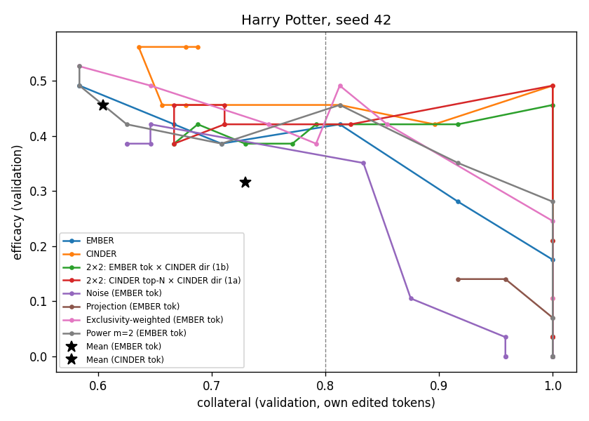
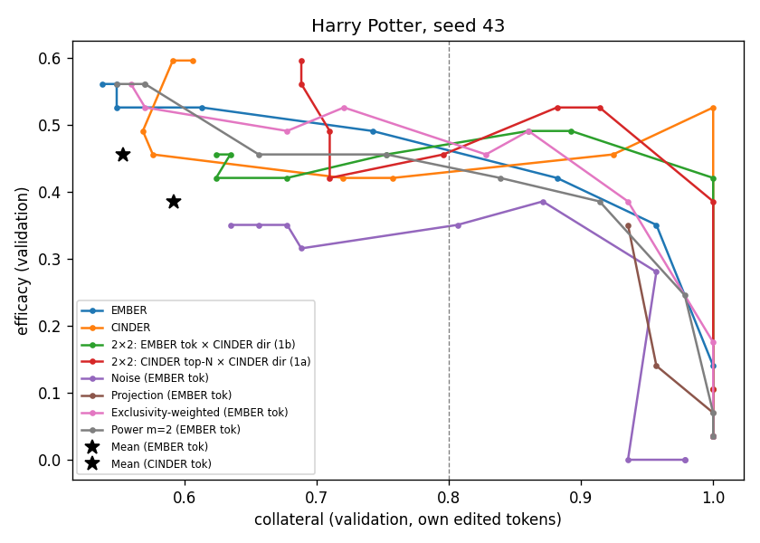
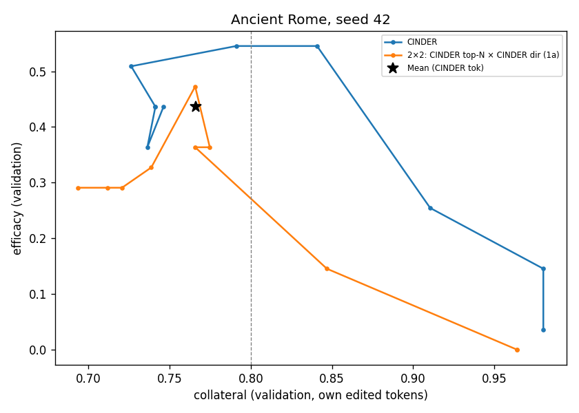
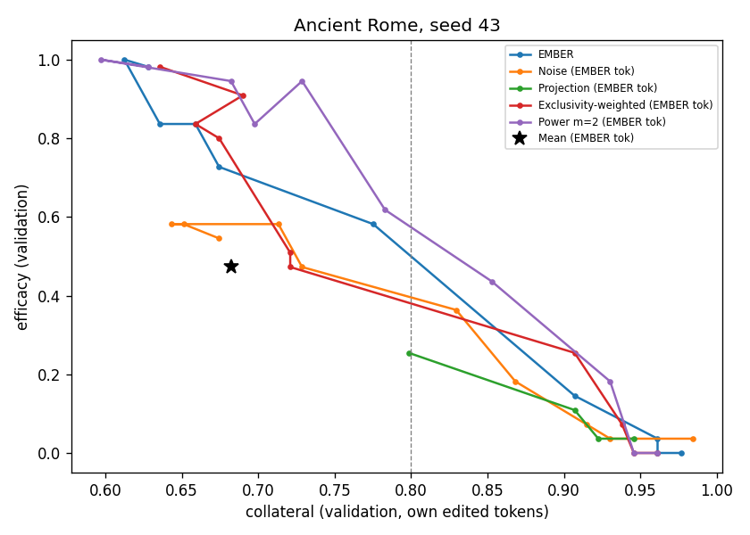
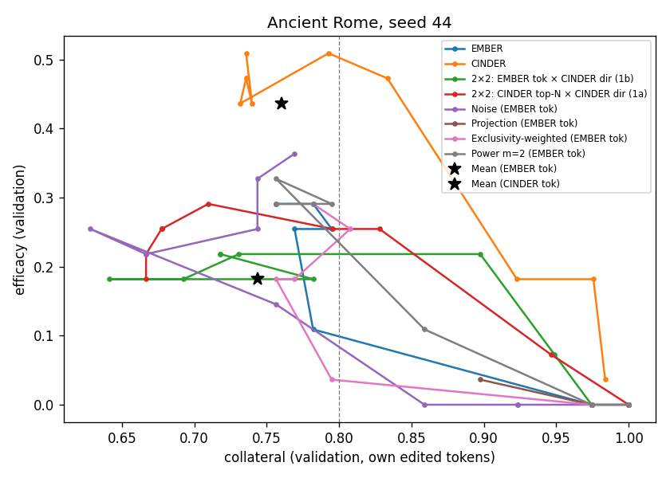
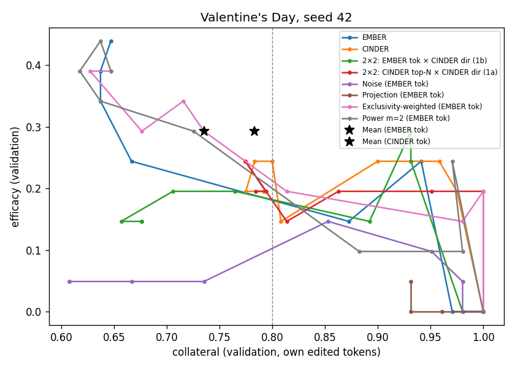
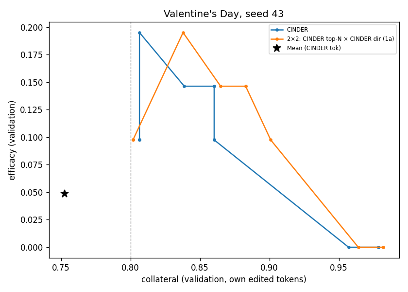
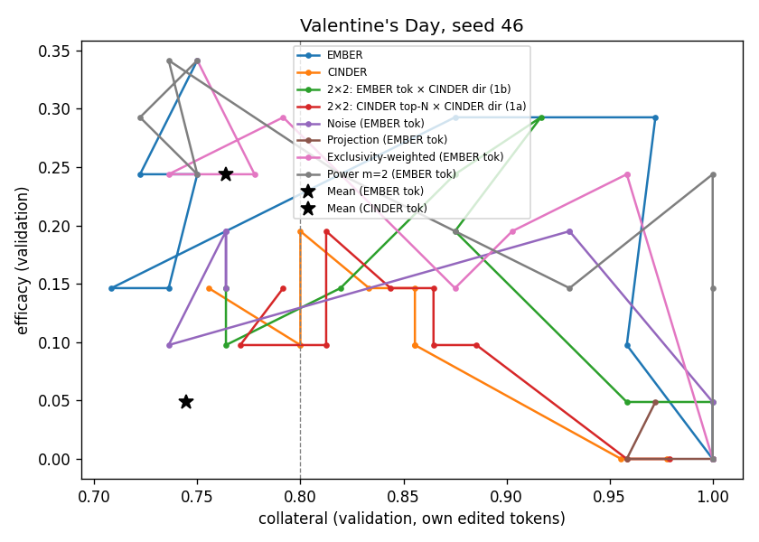

# Collateral-aware erasure: development stage (Harry Potter, Ancient Rome, Valentine's Day)

Pre-registered in PREREG amendment 3. Question set `data/collateral_questions.json` (sha256[:16] 57b21bb9dfcecfc2).
Selection on validation by HM(efficacy, specificity, collateral) under gates MMLU-frac ≥ 0.9 and collateral ≥ 0.8; the test split is scored at the chosen point. Collateral = mean over the variant's own edited multi-meaning tokens of mc_norm(token accuracy, 1). H = paper (efficacy, specificity, coherence); H4 adds collateral; H3v = HM(efficacy, specificity, collateral) (no Alpaca).

## Test results at the selected point

Collateral (rn) is normalized by the unedited model's test accuracy per token (erratum, amendment 6); the raw column assumes a baseline of 1.

| Concept | Seed | Variant | r | n edit | Efficacy | Specificity | Collateral (rn) | Coll. raw | Coherence | H | H4 (rn) | H3v (rn) |
|---|---|---|---|---|---|---|---|---|---|---|---|---|
| Ancient Rome | 42 | Exclusivity-weighted (CINDER tok) | 0.500 | 92 | 0.19 | 1.00 | 0.88 | 0.87 | — | — | — | 0.40 |
| Ancient Rome | 42 | Mean (CINDER tok) | 0.000 | 0 | 0.00 | 1.00 | 1.00 | 0.97 | — | — | — | 0.00 |
| Ancient Rome | 42 | Noise (CINDER tok) | 1.000 | 92 | 0.26 | 0.96 | 0.85 | 0.84 | — | — | — | 0.50 |
| Ancient Rome | 42 | Power m=1.5 (CINDER tok) | 1.000 | 92 | 0.23 | 0.98 | 0.83 | 0.82 | — | — | — | 0.45 |
| Ancient Rome | 42 | Power m=2 (CINDER tok) | 1.000 | 92 | 0.30 | 0.98 | 0.84 | 0.83 | 0.99 | 0.56 | 0.61 | 0.54 |
| Ancient Rome | 42 | Projection (CINDER tok) | 0.406 | 92 | 0.34 | 0.98 | 0.91 | 0.89 | — | — | — | 0.59 |
| Ancient Rome | 42 | 2×2: CINDER top-N × CINDER dir (1a) | 0.250 | 48 | 0.11 | 1.00 | 0.98 | 0.96 | 0.99 | 0.28 | 0.34 | 0.28 |
| Ancient Rome | 42 | CINDER | 0.500 | 92 | 0.26 | 1.00 | 0.87 | 0.86 | 0.98 | 0.52 | 0.58 | 0.51 |
| Ancient Rome | 42 | EMBER + TJ∨WJ+share | 0.500 | 56 | 0.00 | 0.98 | 0.93 | 0.92 | 0.98 | 0.00 | 0.00 | 0.00 |
| Ancient Rome | 43 | Exclusivity-weighted (EMBER tok) | 0.500 | 59 | 0.19 | 1.00 | 0.93 | 0.93 | — | — | — | 0.41 |
| Ancient Rome | 43 | Mean (EMBER tok) | 0.000 | 0 | 0.00 | 1.00 | 1.00 | 0.98 | — | — | — | 0.00 |
| Ancient Rome | 43 | Noise (EMBER tok) | 1.000 | 59 | 0.19 | 0.98 | 0.90 | 0.90 | — | — | — | 0.40 |
| Ancient Rome | 43 | Power m=1.5 (EMBER tok) | 0.500 | 59 | 0.15 | 1.00 | 0.91 | 0.90 | — | — | — | 0.34 |
| Ancient Rome | 43 | Power m=2 (EMBER tok) | 0.500 | 59 | 0.19 | 1.00 | 0.95 | 0.94 | — | — | — | 0.41 |
| Ancient Rome | 43 | Projection (EMBER tok) | 0.000 | 0 | 0.00 | 1.00 | 1.00 | 0.98 | — | — | — | 0.00 |
| Ancient Rome | 43 | 2×2: EMBER tok × EMBER dir (dense) | 0.500 | 59 | 0.15 | 1.00 | 0.98 | 0.96 | — | — | — | 0.35 |
| Ancient Rome | 43 | EMBER | 0.500 | 59 | 0.19 | 1.00 | 0.98 | 0.96 | 0.98 | 0.41 | 0.48 | 0.41 |
| Ancient Rome | 44 | Exclusivity-weighted (CINDER tok) | 1.000 | 103 | 0.34 | 0.96 | 0.88 | 0.85 | — | — | — | 0.59 |
| Ancient Rome | 44 | Exclusivity-weighted (EMBER tok) | 10.000 | 38 | 0.08 | 0.98 | 0.72 | 0.69 | — | — | — | 0.19 |
| Ancient Rome | 44 | Mean (CINDER tok) | 0.000 | 0 | 0.00 | 1.00 | 1.00 | 0.96 | — | — | — | 0.00 |
| Ancient Rome | 44 | Mean (EMBER tok) | 0.000 | 0 | 0.00 | 1.00 | 1.00 | 0.96 | — | — | — | 0.00 |
| Ancient Rome | 44 | Noise (CINDER tok) | 1.000 | 103 | 0.34 | 0.95 | 0.85 | 0.84 | — | — | — | 0.58 |
| Ancient Rome | 44 | Noise (EMBER tok) | 0.050 | 38 | 0.00 | 1.00 | 1.00 | 0.96 | — | — | — | 0.00 |
| Ancient Rome | 44 | Power m=1.5 (CINDER tok) | 0.500 | 103 | 0.42 | 0.98 | 0.89 | 0.88 | — | — | — | 0.66 |
| Ancient Rome | 44 | Power m=1.5 (EMBER tok) | 1.000 | 38 | 0.08 | 1.00 | 0.77 | 0.74 | — | — | — | 0.19 |
| Ancient Rome | 44 | Power m=2 (CINDER tok) | 1.000 | 103 | 0.23 | 0.93 | 0.85 | 0.85 | 0.97 | 0.46 | 0.52 | 0.45 |
| Ancient Rome | 44 | Power m=2 (EMBER tok) | 1.000 | 38 | 0.08 | 1.00 | 0.81 | 0.78 | — | — | — | 0.19 |
| Ancient Rome | 44 | Projection (CINDER tok) | 0.438 | 103 | 0.30 | 0.98 | 0.95 | 0.92 | — | — | — | 0.56 |
| Ancient Rome | 44 | Projection (EMBER tok) | 0.698 | 38 | 0.08 | 1.00 | 0.92 | 0.88 | — | — | — | 0.20 |
| Ancient Rome | 44 | 2×2: CINDER top-N × CINDER dir (1a) | 0.500 | 38 | 0.26 | 1.00 | 0.93 | 0.90 | 0.94 | 0.51 | 0.58 | 0.51 |
| Ancient Rome | 44 | 2×2: EMBER tok × CINDER dir (1b) | 0.500 | 38 | 0.11 | 0.98 | 0.89 | 0.90 | 0.97 | 0.28 | 0.33 | 0.27 |
| Ancient Rome | 44 | CINDER | 0.500 | 103 | 0.38 | 0.98 | 0.91 | 0.90 | 0.96 | 0.64 | 0.69 | 0.63 |
| Ancient Rome | 44 | 2×2: CINDER top-N × EMBER dir | 0.500 | 38 | 0.04 | 1.00 | 0.94 | 0.89 | — | — | — | 0.11 |
| Ancient Rome | 44 | 2×2: EMBER tok × EMBER dir (dense) | 0.050 | 38 | 0.00 | 1.00 | 1.00 | 0.96 | — | — | — | 0.00 |
| Ancient Rome | 44 | EMBER | 0.050 | 38 | 0.00 | 1.00 | 1.00 | 0.96 | 0.99 | 0.00 | 0.00 | 0.00 |
| Harry Potter | 42 | Exclusivity-weighted (CINDER tok) | 0.500 | 51 | 0.32 | 1.00 | 0.96 | 0.96 | — | — | — | 0.58 |
| Harry Potter | 42 | Exclusivity-weighted (EMBER tok) | 2.000 | 31 | 0.32 | 1.00 | 0.87 | 0.88 | — | — | — | 0.57 |
| Harry Potter | 42 | Mean (CINDER tok) | 0.000 | 0 | 0.00 | 1.00 | 1.00 | 0.97 | — | — | — | 0.00 |
| Harry Potter | 42 | Mean (EMBER tok) | 0.000 | 0 | 0.00 | 1.00 | 1.00 | 0.94 | — | — | — | 0.00 |
| Harry Potter | 42 | Noise (CINDER tok) | 0.500 | 51 | 0.13 | 1.00 | 0.96 | 0.96 | — | — | — | 0.30 |
| Harry Potter | 42 | Noise (EMBER tok) | 2.000 | 31 | 0.22 | 1.00 | 0.91 | 0.85 | — | — | — | 0.45 |
| Harry Potter | 42 | Power m=1.5 (CINDER tok) | 0.250 | 51 | 0.25 | 1.00 | 0.94 | 0.91 | — | — | — | 0.50 |
| Harry Potter | 42 | Power m=1.5 (EMBER tok) | 2.000 | 31 | 0.32 | 1.00 | 0.76 | 0.77 | — | — | — | 0.55 |
| Harry Potter | 42 | Power m=2 (CINDER tok) | 0.250 | 51 | 0.22 | 1.00 | 0.96 | 0.93 | 0.99 | 0.46 | 0.53 | 0.46 |
| Harry Potter | 42 | Power m=2 (EMBER tok) | 2.000 | 31 | 0.32 | 1.00 | 0.84 | 0.85 | — | — | — | 0.56 |
| Harry Potter | 42 | Projection (CINDER tok) | 0.357 | 51 | 0.25 | 1.00 | 0.96 | 0.93 | — | — | — | 0.50 |
| Harry Potter | 42 | Projection (EMBER tok) | 0.623 | 31 | 0.13 | 1.00 | 0.96 | 0.90 | — | — | — | 0.30 |
| Harry Potter | 42 | 2×2: CINDER top-N × CINDER dir (1a) | 0.500 | 31 | 0.22 | 1.00 | 0.90 | 0.84 | 0.98 | 0.46 | 0.52 | 0.45 |
| Harry Potter | 42 | 2×2: EMBER tok × CINDER dir (1b) | 0.500 | 31 | 0.25 | 1.00 | 0.96 | 0.90 | 1.00 | 0.51 | 0.57 | 0.50 |
| Harry Potter | 42 | CINDER | 0.250 | 51 | 0.25 | 1.00 | 0.96 | 0.93 | 1.00 | 0.51 | 0.57 | 0.50 |
| Harry Potter | 42 | 2×2: CINDER top-N × EMBER dir | 2.000 | 31 | 0.29 | 1.00 | 0.88 | 0.89 | — | — | — | 0.53 |
| Harry Potter | 42 | 2×2: EMBER tok × EMBER dir (dense) | 2.000 | 31 | 0.32 | 1.00 | 0.76 | 0.77 | — | — | — | 0.55 |
| Harry Potter | 42 | EMBER | 2.000 | 31 | 0.32 | 1.00 | 0.76 | 0.77 | 0.98 | 0.58 | 0.62 | 0.55 |
| Harry Potter | 43 | Exclusivity-weighted (CINDER tok) | 0.500 | 63 | 0.29 | 1.00 | 0.97 | 0.97 | — | — | — | 0.54 |
| Harry Potter | 43 | Exclusivity-weighted (EMBER tok) | 1.000 | 47 | 0.29 | 1.00 | 0.96 | 0.96 | — | — | — | 0.54 |
| Harry Potter | 43 | Mean (CINDER tok) | 0.000 | 0 | 0.00 | 1.00 | 1.00 | 0.98 | — | — | — | 0.00 |
| Harry Potter | 43 | Mean (EMBER tok) | 0.000 | 0 | 0.00 | 1.00 | 1.00 | 0.97 | — | — | — | 0.00 |
| Harry Potter | 43 | Noise (CINDER tok) | 1.000 | 63 | 0.16 | 1.00 | 0.93 | 0.93 | — | — | — | 0.36 |
| Harry Potter | 43 | Noise (EMBER tok) | 1.000 | 47 | 0.22 | 1.00 | 0.86 | 0.86 | — | — | — | 0.45 |
| Harry Potter | 43 | Power m=1.5 (CINDER tok) | 0.250 | 63 | 0.25 | 1.00 | 0.95 | 0.93 | — | — | — | 0.50 |
| Harry Potter | 43 | Power m=1.5 (EMBER tok) | 1.000 | 47 | 0.32 | 1.00 | 0.90 | 0.90 | — | — | — | 0.57 |
| Harry Potter | 43 | Power m=2 (CINDER tok) | 0.250 | 63 | 0.25 | 1.00 | 0.97 | 0.95 | 0.99 | 0.50 | 0.57 | 0.50 |
| Harry Potter | 43 | Power m=2 (EMBER tok) | 1.000 | 47 | 0.29 | 1.00 | 0.89 | 0.89 | — | — | — | 0.53 |
| Harry Potter | 43 | Projection (CINDER tok) | 0.360 | 63 | 0.22 | 1.00 | 0.97 | 0.95 | — | — | — | 0.46 |
| Harry Potter | 43 | Projection (EMBER tok) | 0.591 | 47 | 0.13 | 1.00 | 0.93 | 0.90 | — | — | — | 0.30 |
| Harry Potter | 43 | 2×2: CINDER top-N × CINDER dir (1a) | 0.500 | 47 | 0.25 | 1.00 | 0.93 | 0.90 | 0.96 | 0.50 | 0.57 | 0.50 |
| Harry Potter | 43 | 2×2: EMBER tok × CINDER dir (1b) | 0.500 | 47 | 0.25 | 1.00 | 0.93 | 0.90 | 0.99 | 0.50 | 0.57 | 0.50 |
| Harry Potter | 43 | CINDER | 0.250 | 63 | 0.22 | 1.00 | 0.97 | 0.95 | 0.98 | 0.46 | 0.53 | 0.46 |
| Harry Potter | 43 | 2×2: CINDER top-N × EMBER dir | 0.500 | 47 | 0.25 | 1.00 | 0.96 | 0.92 | — | — | — | 0.50 |
| Harry Potter | 43 | 2×2: EMBER tok × EMBER dir (dense) | 1.000 | 47 | 0.32 | 1.00 | 0.90 | 0.90 | — | — | — | 0.57 |
| Harry Potter | 43 | EMBER | 1.000 | 47 | 0.32 | 1.00 | 0.90 | 0.90 | 1.00 | 0.58 | 0.64 | 0.57 |
| Valentine's Day | 42 | Exclusivity-weighted (CINDER tok) | 0.250 | 52 | 0.30 | 1.00 | 1.00 | 0.94 | — | — | — | 0.56 |
| Valentine's Day | 42 | Exclusivity-weighted (EMBER tok) | 0.250 | 45 | 0.37 | 1.00 | 1.00 | 0.90 | — | — | — | 0.64 |
| Valentine's Day | 42 | Mean (CINDER tok) | 0.000 | 0 | 0.00 | 1.00 | 1.00 | 0.94 | — | — | — | 0.00 |
| Valentine's Day | 42 | Mean (EMBER tok) | 0.000 | 0 | 0.00 | 1.00 | 1.00 | 0.88 | — | — | — | 0.00 |
| Valentine's Day | 42 | Noise (CINDER tok) | 2.000 | 52 | 0.37 | 0.98 | 0.89 | 0.85 | — | — | — | 0.62 |
| Valentine's Day | 42 | Noise (EMBER tok) | 2.000 | 45 | 0.52 | 1.00 | 0.82 | 0.78 | — | — | — | 0.72 |
| Valentine's Day | 42 | Power m=1.5 (CINDER tok) | 0.250 | 52 | 0.22 | 1.00 | 0.98 | 0.93 | — | — | — | 0.46 |
| Valentine's Day | 42 | Power m=1.5 (EMBER tok) | 1.000 | 45 | 0.37 | 1.00 | 0.91 | 0.82 | — | — | — | 0.62 |
| Valentine's Day | 42 | Power m=2 (CINDER tok) | 2.000 | 52 | 0.22 | 1.00 | 0.89 | 0.88 | 0.99 | 0.46 | 0.52 | 0.45 |
| Valentine's Day | 42 | Power m=2 (EMBER tok) | 0.250 | 45 | 0.22 | 1.00 | 1.00 | 0.90 | — | — | — | 0.46 |
| Valentine's Day | 42 | Projection (CINDER tok) | 0.303 | 52 | 0.37 | 1.00 | 0.98 | 0.93 | — | — | — | 0.64 |
| Valentine's Day | 42 | Projection (EMBER tok) | 0.565 | 45 | 0.37 | 1.00 | 0.96 | 0.84 | — | — | — | 0.63 |
| Valentine's Day | 42 | 2×2: CINDER top-N × CINDER dir (1a) | 0.250 | 45 | 0.37 | 1.00 | 1.00 | 0.93 | 0.98 | 0.64 | 0.70 | 0.64 |
| Valentine's Day | 42 | 2×2: EMBER tok × CINDER dir (1b) | 0.500 | 45 | 0.30 | 1.00 | 0.97 | 0.86 | 0.98 | 0.56 | 0.62 | 0.55 |
| Valentine's Day | 42 | CINDER | 0.500 | 52 | 0.22 | 1.00 | 0.96 | 0.90 | 0.97 | 0.46 | 0.53 | 0.46 |
| Valentine's Day | 42 | 2×2: CINDER top-N × EMBER dir | 0.500 | 45 | 0.22 | 1.00 | 0.98 | 0.96 | — | — | — | 0.46 |
| Valentine's Day | 42 | 2×2: EMBER tok × EMBER dir (dense) | 0.500 | 45 | 0.30 | 1.00 | 0.98 | 0.86 | — | — | — | 0.56 |
| Valentine's Day | 42 | EMBER | 0.500 | 45 | 0.22 | 1.00 | 0.98 | 0.86 | 0.99 | 0.46 | 0.53 | 0.46 |
| Valentine's Day | 43 | Exclusivity-weighted (CINDER tok) | 1.000 | 33 | 0.22 | 1.00 | 0.87 | 0.83 | — | — | — | 0.45 |
| Valentine's Day | 43 | Mean (CINDER tok) | 0.000 | 0 | 0.00 | 1.00 | 1.00 | 0.96 | — | — | — | 0.00 |
| Valentine's Day | 43 | Noise (CINDER tok) | 0.500 | 33 | 0.00 | 1.00 | 0.96 | 0.91 | — | — | — | 0.00 |
| Valentine's Day | 43 | Power m=1.5 (CINDER tok) | 2.000 | 33 | 0.07 | 1.00 | 0.74 | 0.70 | — | — | — | 0.19 |
| Valentine's Day | 43 | Power m=2 (CINDER tok) | 2.000 | 33 | 0.07 | 1.00 | 0.77 | 0.73 | 0.94 | 0.19 | 0.24 | 0.19 |
| Valentine's Day | 43 | Projection (CINDER tok) | 0.126 | 33 | 0.00 | 1.00 | 0.95 | 0.90 | — | — | — | 0.00 |
| Valentine's Day | 43 | 2×2: CINDER top-N × CINDER dir (1a) | 5.000 | 39 | 0.00 | 1.00 | 0.69 | 0.66 | 0.96 | 0.00 | 0.00 | 0.00 |
| Valentine's Day | 43 | CINDER | 5.000 | 33 | 0.07 | 1.00 | 0.68 | 0.63 | 0.96 | 0.19 | 0.24 | 0.19 |
| Valentine's Day | 46 | Exclusivity-weighted (CINDER tok) | 2.000 | 32 | 0.07 | 1.00 | 0.76 | 0.71 | — | — | — | 0.19 |
| Valentine's Day | 46 | Exclusivity-weighted (EMBER tok) | 0.250 | 34 | 0.37 | 1.00 | 1.00 | 0.93 | — | — | — | 0.64 |
| Valentine's Day | 46 | Mean (CINDER tok) | 0.000 | 0 | 0.00 | 1.00 | 1.00 | 0.96 | — | — | — | 0.00 |
| Valentine's Day | 46 | Mean (EMBER tok) | 0.000 | 0 | 0.00 | 1.00 | 1.00 | 0.93 | — | — | — | 0.00 |
| Valentine's Day | 46 | Noise (CINDER tok) | 5.000 | 32 | 0.00 | 1.00 | 0.79 | 0.74 | — | — | — | 0.00 |
| Valentine's Day | 46 | Noise (EMBER tok) | 0.500 | 34 | 0.15 | 0.98 | 1.00 | 0.93 | — | — | — | 0.34 |
| Valentine's Day | 46 | Power m=1.5 (CINDER tok) | 2.000 | 32 | 0.07 | 1.00 | 0.73 | 0.69 | — | — | — | 0.19 |
| Valentine's Day | 46 | Power m=1.5 (EMBER tok) | 0.250 | 34 | 0.30 | 1.00 | 1.00 | 0.93 | — | — | — | 0.56 |
| Valentine's Day | 46 | Power m=2 (CINDER tok) | 2.000 | 32 | 0.00 | 1.00 | 0.77 | 0.72 | 0.94 | 0.00 | 0.00 | 0.00 |
| Valentine's Day | 46 | Power m=2 (EMBER tok) | 0.250 | 34 | 0.37 | 1.00 | 0.97 | 0.90 | — | — | — | 0.63 |
| Valentine's Day | 46 | Projection (CINDER tok) | 0.109 | 32 | 0.00 | 1.00 | 0.94 | 0.90 | — | — | — | 0.00 |
| Valentine's Day | 46 | Projection (EMBER tok) | 0.487 | 34 | 0.15 | 1.00 | 1.00 | 0.93 | — | — | — | 0.34 |
| Valentine's Day | 46 | 2×2: CINDER top-N × CINDER dir (1a) | 5.000 | 34 | 0.00 | 1.00 | 0.72 | 0.68 | 0.94 | 0.00 | 0.00 | 0.00 |
| Valentine's Day | 46 | 2×2: EMBER tok × CINDER dir (1b) | 1.000 | 34 | 0.22 | 0.98 | 0.91 | 0.85 | 0.99 | 0.46 | 0.52 | 0.45 |
| Valentine's Day | 46 | CINDER | 5.000 | 32 | 0.07 | 1.00 | 0.72 | 0.68 | 0.95 | 0.19 | 0.24 | 0.19 |
| Valentine's Day | 46 | 2×2: CINDER top-N × EMBER dir | 2.000 | 34 | 0.00 | 1.00 | 0.86 | 0.82 | — | — | — | 0.00 |
| Valentine's Day | 46 | 2×2: EMBER tok × EMBER dir (dense) | 0.500 | 34 | 0.30 | 0.98 | 0.97 | 0.90 | — | — | — | 0.55 |
| Valentine's Day | 46 | EMBER | 0.500 | 34 | 0.30 | 0.98 | 0.97 | 0.90 | 0.99 | 0.56 | 0.62 | 0.55 |

## Mean over concept-seeds (variants present in every run of the concept are averaged over those runs)

| Variant | runs | Efficacy | Collateral (rn) | H3v (rn) | H4 rn (if Alpaca) | H3v raw | mean selected r |
|---|---|---|---|---|---|---|---|
| Exclusivity-weighted (EMBER tok) | 6 | 0.27 | 0.91 | 0.50 | — | 0.49 | 2.33 |
| Power m=1.5 (EMBER tok) | 6 | 0.25 | 0.87 | 0.47 | — | 0.47 | 0.96 |
| Exclusivity-weighted (CINDER tok) | 7 | 0.25 | 0.90 | 0.47 | — | 0.47 | 0.82 |
| Power m=2 (EMBER tok) | 6 | 0.24 | 0.91 | 0.47 | — | 0.46 | 0.83 |
| 2×2: EMBER tok × CINDER dir (1b) | 5 | 0.23 | 0.93 | 0.46 | 0.52 | 0.45 | 0.60 |
| 2×2: EMBER tok × EMBER dir (dense) | 6 | 0.23 | 0.93 | 0.43 | — | 0.43 | 0.76 |
| EMBER | 6 | 0.22 | 0.93 | 0.42 | 0.48 | 0.42 | 0.76 |
| Power m=1.5 (CINDER tok) | 7 | 0.22 | 0.87 | 0.42 | — | 0.42 | 0.89 |
| CINDER | 7 | 0.21 | 0.87 | 0.42 | 0.48 | 0.42 | 1.71 |
| Noise (EMBER tok) | 6 | 0.22 | 0.91 | 0.40 | — | 0.39 | 1.09 |
| Projection (CINDER tok) | 7 | 0.21 | 0.95 | 0.39 | — | 0.39 | 0.30 |
| Power m=2 (CINDER tok) | 7 | 0.19 | 0.86 | 0.37 | 0.43 | 0.37 | 1.21 |
| 2×2: CINDER top-N × CINDER dir (1a) | 7 | 0.17 | 0.88 | 0.34 | 0.39 | 0.34 | 1.71 |
| Noise (CINDER tok) | 7 | 0.18 | 0.89 | 0.34 | — | 0.34 | 1.57 |
| 2×2: CINDER top-N × EMBER dir | 5 | 0.16 | 0.93 | 0.32 | — | 0.32 | 1.10 |
| Projection (EMBER tok) | 6 | 0.14 | 0.96 | 0.30 | — | 0.29 | 0.49 |
| Mean (EMBER tok) | 6 | 0.00 | 1.00 | 0.00 | — | 0.00 | 0.00 |
| Mean (CINDER tok) | 7 | 0.00 | 1.00 | 0.00 | — | 0.00 | 0.00 |
| EMBER + TJ∨WJ+share | 1 | 0.00 | 0.93 | 0.00 | 0.00 | 0.00 | 0.50 |

## 2×2: token set × direction (dense Y, N = EMBER's edit count), test H3v

| Concept | Seed | EE | 1b (CINDER dir) | 1a (CINDER tok+dir) | cross (CINDER tok) | Δ direction | Δ tokens | Δ interaction |
|---|---|---|---|---|---|---|---|---|
| Harry Potter | 42 | 0.55 | 0.50 | 0.45 | 0.53 | -0.06 | -0.03 | -0.03 |
| Harry Potter | 43 | 0.57 | 0.50 | 0.50 | 0.50 | -0.04 | -0.03 | +0.07 |
| Ancient Rome | 44 | 0.00 | 0.27 | 0.51 | 0.11 | +0.34 | +0.17 | +0.13 |
| Valentine's Day | 42 | 0.56 | 0.55 | 0.64 | 0.46 | +0.09 | -0.01 | +0.18 |
| Valentine's Day | 46 | 0.55 | 0.45 | 0.00 | 0.00 | -0.05 | -0.50 | +0.10 |
| **mean** | | | | | | **+0.06** | **-0.08** | |

## Regime shift: selected r without vs with the collateral term (validation)

| Concept | Seed | Variant | r, H2 rule (paper-style, no collateral) | r, collateral rule | efficacy H2→coll | collateral H2→coll |
|---|---|---|---|---|---|---|
| Ancient Rome | 42 | CINDER | 0.500 | 0.500 | 0.55→0.55 | 0.84→0.84 |
| Ancient Rome | 42 | EMBER + TJ∨WJ+share | 100.000 | 0.500 | 0.95→0.22 | 0.21→0.82 |
| Ancient Rome | 43 | EMBER | 30.000 | 0.500 | 1.00→0.15 | 0.61→0.91 |
| Ancient Rome | 44 | CINDER | 100.000 | 0.500 | 0.51→0.47 | 0.74→0.83 |
| Ancient Rome | 44 | EMBER | 10.000 | 0.050 | 0.29→0.00 | 0.78→1.00 |
| Harry Potter | 42 | CINDER | 10.000 | 0.250 | 0.56→0.49 | 0.64→1.00 |
| Harry Potter | 42 | EMBER | 30.000 | 2.000 | 0.49→0.42 | 0.58→0.81 |
| Harry Potter | 43 | CINDER | 30.000 | 0.250 | 0.60→0.53 | 0.59→1.00 |
| Harry Potter | 43 | EMBER | 30.000 | 1.000 | 0.56→0.42 | 0.55→0.88 |
| Valentine's Day | 42 | CINDER | 0.500 | 0.500 | 0.24→0.24 | 0.96→0.96 |
| Valentine's Day | 42 | EMBER | 100.000 | 0.500 | 0.44→0.24 | 0.65→0.94 |
| Valentine's Day | 43 | CINDER | 5.000 | 5.000 | 0.20→0.20 | 0.81→0.81 |
| Valentine's Day | 46 | CINDER | 5.000 | 5.000 | 0.20→0.20 | 0.80→0.80 |
| Valentine's Day | 46 | EMBER | 100.000 | 0.500 | 0.34→0.29 | 0.75→0.97 |

## Gate sensitivity (validation H3v of the selected point, mean over concept-seeds)

| Variant | gate 0.7 | gate 0.8 | gate 0.9 |
|---|---|---|---|
| Exclusivity-weighted (CINDER tok) | 0.58 | 0.57 | 0.45 |
| Exclusivity-weighted (EMBER tok) | 0.63 | 0.55 | 0.42 |
| Mean (CINDER tok) | 0.30 | 0.00 | 0.00 |
| Mean (EMBER tok) | 0.32 | 0.00 | 0.00 |
| Noise (CINDER tok) | 0.53 | 0.47 | 0.30 |
| Noise (EMBER tok) | 0.55 | 0.43 | 0.25 |
| Power m=1.5 (CINDER tok) | 0.60 | 0.58 | 0.46 |
| Power m=1.5 (EMBER tok) | 0.61 | 0.54 | 0.35 |
| Power m=2 (CINDER tok) | 0.58 | 0.58 | 0.41 |
| Power m=2 (EMBER tok) | 0.64 | 0.54 | 0.44 |
| Projection (CINDER tok) | 0.46 | 0.46 | 0.46 |
| Projection (EMBER tok) | 0.30 | 0.26 | 0.24 |
| 2×2: CINDER top-N × CINDER dir (1a) | 0.57 | 0.51 | 0.34 |
| 2×2: EMBER tok × CINDER dir (1b) | 0.59 | 0.59 | 0.54 |
| CINDER | 0.61 | 0.61 | 0.41 |
| CINDER-RS (CS + RS-1% + TWJ) | 0.53 | 0.48 | 0.47 |
| 2×2: CINDER top-N × EMBER dir | 0.55 | 0.45 | 0.42 |
| 2×2: EMBER tok × EMBER dir (dense) | 0.59 | 0.46 | 0.43 |
| EMBER | 0.61 | 0.45 | 0.42 |
| EMBER + TJ∨WJ+share | 0.69 | 0.44 | 0.10 |

## Pooled edit-shape choice (validation)

```json
{
 "alpha": {
  "ember": {
   "0.25": [
    0.03330969331623974,
    6
   ],
   "0.5": [
    0.07843946991795302,
    6
   ],
   "0.75": [
    0.15342923872055556,
    6
   ],
   "1.0": [
    0.21712886403547968,
    6
   ]
  },
  "cinder": {
   "0.25": [
    0.10710546024374004,
    7
   ],
   "0.5": [
    0.2708262608343413,
    7
   ],
   "0.75": [
    0.3966402919972711,
    7
   ],
   "1.0": [
    0.45470846308629104,
    7
   ]
  }
 },
 "shape": {
  "proj:ember": [
   0.21712886403547968,
   6
  ],
  "excl:ember": [
   0.5518375537754137,
   6
  ],
  "pow1.5:ember": [
   0.5356754867648006,
   6
  ],
  "pow2.0:ember": [
   0.5421710296813295,
   6
  ],
  "proj:cinder": [
   0.45470846308629104,
   7
  ],
  "excl:cinder": [
   0.569854077832514,
   7
  ],
  "pow1.5:cinder": [
   0.580253134736239,
   7
  ],
  "pow2.0:cinder": [
   0.5804215232560571,
   7
  ]
 },
 "best_alpha": {
  "ember": 1.0,
  "cinder": 1.0
 },
 "best_shape": "pow2.0:cinder"
}
```

## Pareto curves (validation)









